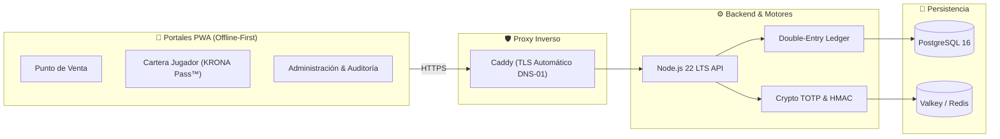

# KRONA VAULT™

[](https://github.com/chamakov/krona-vault/actions/workflows/ci.yml)
[](https://nodejs.org/)
[](https://www.typescriptlang.org/)
[](./LICENSE)
[](./docker-compose.yml)
[](./playwright.config.ts)

> 🌐 **Idiomas / Languages**: [ 🇲🇽 Español ](./README.es.md) · [ 🇺🇸 English ](./README.md)

**KRONA VAULT™** es un ecosistema auto-hospedado (*Self-Hosted*, listo para **Proxmox VE + Docker Compose** o **Edge Serverless**) de grado institucional para la gestión contable, operativa y criptográfica de **crédito en tienda (*Store Credit*)**, emisión de vouchers físicos de caja con sellos anti-falsificación, dispersión de premios de torneos, control de resguardos/escrow de artículos coleccionables y autenticación 2FA offline.

---

## 📑 Tabla de Contenidos

- [Características Principales](#-características-principales)
- [Arquitectura del Sistema](#-arquitectura-del-sistema)
- [Portales Web Incluidos (PWA)](#-portales-web-incluidos-pwa)
- [Inicio Rápido](#-inicio-rápido)
  - [Opción A: Docker Compose (Recomendado)](#opción-a-docker-compose-recomendado)
  - [Opción B: Desarrollo Local con Node.js](#opción-b-desarrollo-local-con-nodejs)
- [Estructura del Monorepo](#-estructura-del-monorepo)
- [Pruebas Automatizadas y Calidad](#-pruebas-automatizadas-y-calidad)
- [Documentación Técnica](#-documentación-técnica)
- [Cómo Contribuir](#-cómo-contribuir)
- [Seguridad](#-seguridad)
- [Licencia](#-licencia)

---

## 🌟 Características Principales

### 1. ⚖️ Contabilidad por Partida Doble Inmutable (Double-Entry Ledger)
- Base de datos PostgreSQL 16 con *triggers* que bloquean `UPDATE` y `DELETE`, forzando que **$\sum \text{Debe} = \sum \text{Haber}$** en cada asiento.
- Bitácora forense encadenada mediante `SHA-256` (`prev_hash` + `row_hash`) y firmada con llave HMAC del servidor.
- Consumo estricto por antigüedad **FEFO** (*First-Expiring, First-Out*), consumiendo primero saldos promocionales con vigencia antes del crédito permanente.

### 2. 🖨️ Emisión de Vouchers Físicos Térmicos (58mm / 80mm)
- Funciona junto a cualquier sistema de punto de venta (POS) existente.
- Cada cobro genera un voucher físico con folio secuencial (`VCH-SUC-YYYYMMDD-XXXX`), desglose de saldos, método 2FA y **Sello Criptográfico (`XXXX-XXXX-XXXX-XXXX`)**.
- **Control Anti-Doble Uso**: La primera impresión sale marcada como `[ ORIGINAL - POLIZA DE CAJA ]`; cualquier reimpresión posterior incrementa `printCount`, queda auditada e imprime `*** COPIA REIMPRESA #N - NO VALIDA ARQUEO ***`.

### 3. 🔐 Autorización 2FA Transaccional & Principio de Cuatro Ojos
- **QR Dinámico TOTP (KRONA Pulse™)**: Rota cada 30 segundos con *nonce* único anti-captura de pantalla.
- **PIN Offline de 6 Dígitos ("Modo Búnker / Modo Sótano")**: Permite al jugador autorizar cobros desde su celular incluso sin cobertura telefónica ni internet en el local.
- **Four-Eyes / Maker-Checker**: Ajustes manuales mayores al umbral y entregas de resguardos exigen co-firma y PIN de un segundo supervisor, bloqueando la auto-aprobación (`actorUserId !== targetUserId`).

### 4. 🏆 Motor de Torneos y Dispersión de Premios
- Partición inteligente de pozos por ocupación y categorías (Master, Senior, Junior).
- Soporte para splits de premios en Top Cut respetando integridad de suma cero y distribución justa de centavos residuales.
- Importación directa de clasificaciones oficiales (e.g. Pokémon TOM / RK9).

### 5. 📦 Bóveda de Resguardo (KRONA Custody™ & Escrow)
- Registro seguro de cartas y artículos dejados a cuenta o en resguardo.
- Asociación de evidencias fotográficas verificadas mediante hash `SHA-256`.
- Soporte para resguardo a nombre de terceros (quién deja vs. quién recoge) con desprecinto y entrega segura validada por Four-Eyes.

### 6. 🌐 Multi-Tienda y Multi-Sede Federada
- Opera en modo agrupado (`ORG_POOLED_SAME_ENTITY`), liquidación automática inter-sucursal (`INTER_STORE_CLEARING` con Cuentas por Cobrar `1201` y Cuentas por Pagar `2201`) o modo aislado (`STORE_ISOLATED`).

---

## 🏛️ Arquitectura del Sistema



---

## 🖥️ Portales Web Incluidos (PWA)

La aplicación incluye 11 portales listos para operar desde cualquier navegador moderno o instalarse como PWA en tabletas y celulares:

| Portal | Ruta | Descripción |
| :--- | :--- | :--- |
| **Punto de Venta (POS)** | `/pos` | Terminal de mostrador para cobros mixtos, validación de QR/PIN y emisión de voucher. |
| **Cartera del Jugador** | `/wallet` | Consulta de saldo, historial de movimientos, QR rotativo y generador de PIN offline. |
| **Torneos** | `/tournaments` | Creación de torneos, inscripción, cálculo de pozo y dispersión de premios. |
| **Trade-In** | `/trade-in` | Recepción de singles/cartas a cambio de saldo de crédito en tienda. |
| **Bóveda de Resguardo** | `/custody` | Control de custodia, asignación de casilleros, precintos fotográficos y entrega 4-ojos. |
| **Auditoría Forense** | `/audit` | Consulta de cadena hash inmutable, reimpresiones de voucher y eventos de seguridad. |
| **Gestión de Sucursales** | `/stores` | Alta, configuración de políticas y administración multi-tienda. |
| **Usuarios y Roles** | `/users` | Control de acceso basado en roles (RBAC) y gestión de personal. |
| **Mi Perfil** | `/profile` | Cambio de contraseña, actualización de PIN y enrolamiento de 2FA. |
| **Inicio de Sesión** | `/login` | Autenticación con credenciales protegidas por scrypt. |
| **Panel Central** | `/` | Vista de inicio con accesos rápidos según el rol autenticado. |

---

## 🚀 Inicio Rápido

### Opción A: Docker Compose (Recomendado)

Ideal para servidores de producción, VPS o pruebas completas con PostgreSQL y Valkey:

1. **Clonar el repositorio**:
   ```bash
   git clone https://github.com/chamakov/krona-vault.git
   cd krona-vault
   ```

2. **Crear archivo de configuración de entorno**:
   ```bash
   cp .env.example .env
   ```
   *(Revisa [docs/ENVIRONMENT_VARIABLES.md](./docs/ENVIRONMENT_VARIABLES.md) para generar claves seguras).*

3. **Iniciar los servicios**:
   ```bash
   docker compose up -d --build
   ```

4. **Acceder a la plataforma**:
   Abre [http://localhost:3000](http://localhost:3000) en tu navegador.

---

### Opción B: Desarrollo Local con Node.js

Requisitos: **Node.js >= 22.23.4** y **npm >= 10.9.9**.

1. **Instalar dependencias del monorepo**:
   ```bash
   npm ci
   ```

2. **Ejecutar pruebas unitarias e integrales**:
   ```bash
   npm test
   ```

3. **Iniciar el servidor de desarrollo**:
   ```bash
   npm run dev:api
   ```
   El servidor estará escuchando en `http://localhost:3000`.

---

## 📦 Estructura del Monorepo

```
krona-vault/
├── apps/
│   ├── api/             # Servidor HTTP, motor contable y endpoints REST
│   └── web-pwa/         # 11 portales PWA responsivos offline-first
├── packages/
│   ├── crypto-totp/     # Algoritmos TOTP, HMAC-SHA256, Base32 y scrypt
│   └── shared-types/    # Contratos y tipos TypeScript compartidos
├── infra/
│   ├── caddy/           # Configuración de proxy inverso Caddyfile
│   └── postgres/        # Script init.sql con triggers contables
├── docs/                # Arquitectura técnica y guías de despliegue
├── e2e/                 # Suites de pruebas con Playwright
├── scripts/             # Utilidades de respaldo y mantenimiento
└── docker-compose.yml   # Orquestación de contenedores
```

---

## 🧪 Pruebas Automatizadas y Calidad

El proyecto cuenta con una cobertura integral de pruebas unitarias, de integración y end-to-end:

```bash
# Comprobación de tipos estricta en todo el monorepo
npm run typecheck

# Pruebas unitarias de criptografía, contabilidad y API REST (59 pruebas)
npm test

# Pruebas End-to-End con Playwright en Chromium
npm run test:e2e
```

---

## 📚 Documentación Técnica

- 📖 [Arquitectura y Diseño del Sistema](./docs/ARCHITECTURE.md)
- 🚀 [Guía de Despliegue en Entornos (Docker / Proxmox / VPS)](./docs/DEPLOYMENT.md)
- ⚙️ [Referencia de Variables de Entorno](./docs/ENVIRONMENT_VARIABLES.md)

---

## 🤝 Cómo Contribuir

¡Las contribuciones de la comunidad son bienvenidas! Si deseas reportar un error, sugerir mejoras o enviar código, consulta nuestra [Guía de Contribución](./CONTRIBUTING.md) y el [Código de Conducta](./CODE_OF_CONDUCT.md).

---

## 🛡️ Seguridad

Para informar sobre vulnerabilidades de seguridad de manera responsable, por favor consulta nuestra [Política de Seguridad](./SECURITY.md).

---

## 📄 Licencia

Este proyecto está bajo la Licencia **MIT**. Consulta el archivo [LICENSE](./LICENSE) para más detalles.
