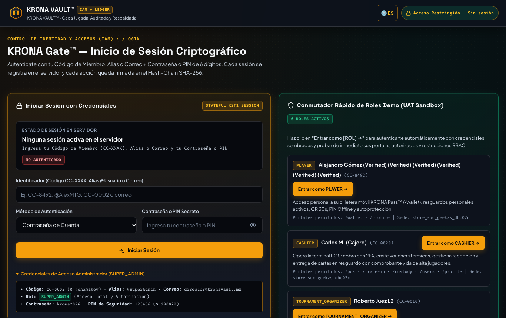
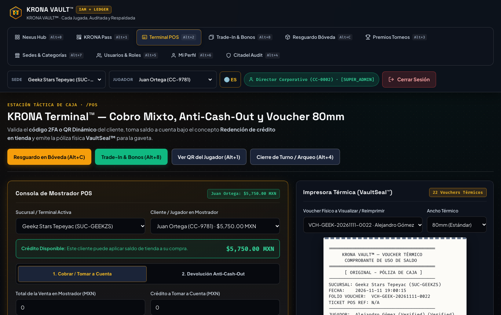
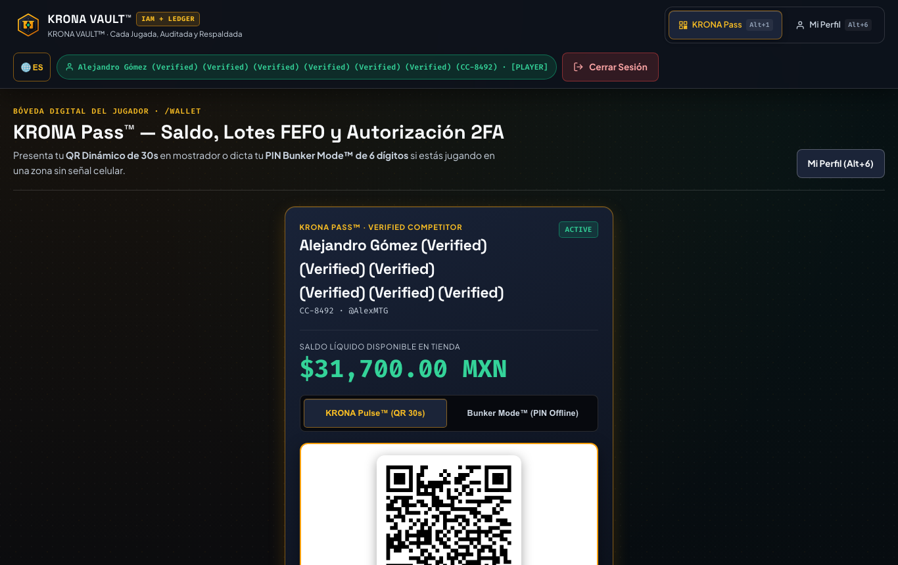
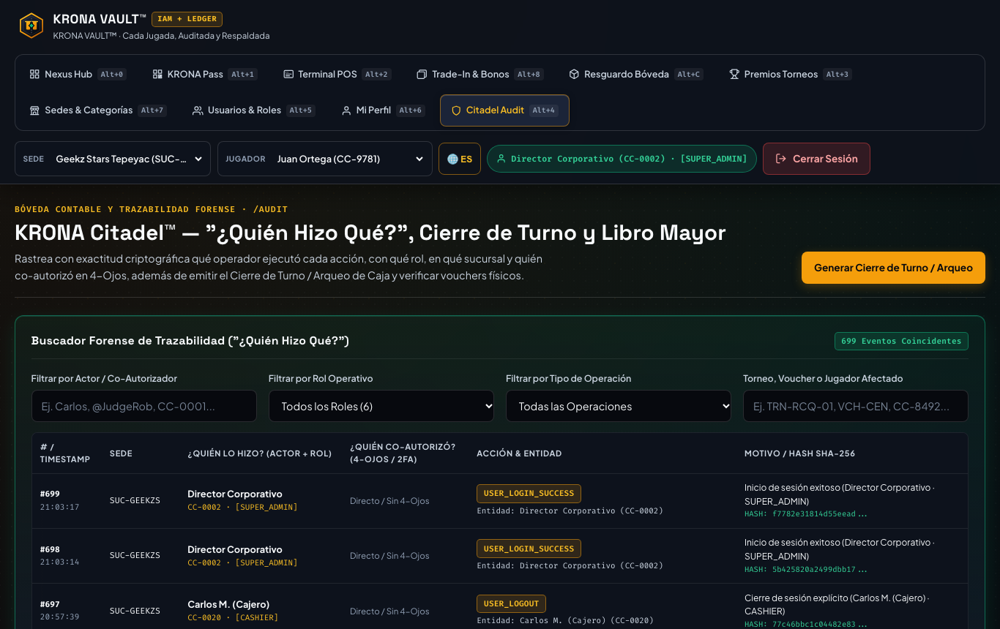
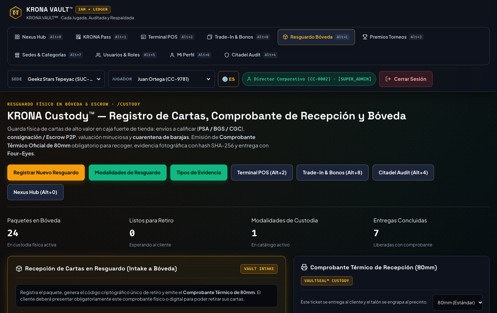
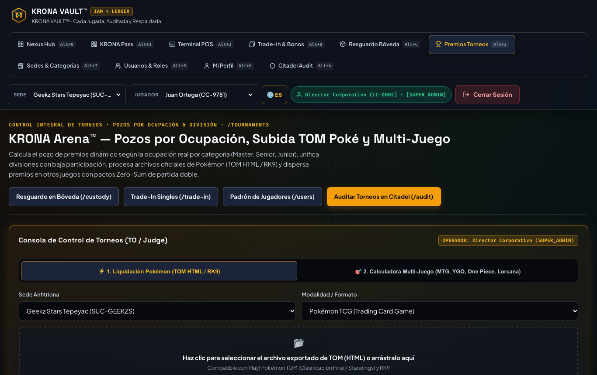
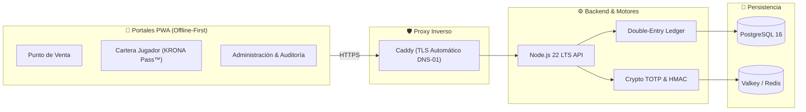

# KRONA VAULT™

[](https://github.com/chamakov/krona-vault/actions/workflows/ci.yml)
[](https://nodejs.org/)
[](https://www.typescriptlang.org/)
[](./LICENSE)
[](./docker-compose.yml)
[](./playwright.config.ts)

> 🌐 **Idiomas / Languages**: [ 🇲🇽 Español ](./README.es.md) · [ 🇺🇸 English ](./README.md)

**KRONA VAULT™** es una plataforma fintech auto-hospedada (*Self-Hosted*, lista para **Proxmox VE + Docker Compose** o **Edge Serverless**) de grado institucional para la gestión contable, operativa y criptográfica de **crédito en tienda (*Store Credit*)**, emisión de vouchers físicos de caja con sellos anti-falsificación, dispersión de premios de torneos, control de resguardos/escrow de artículos coleccionables y autenticación 2FA offline.

---

## 📸 Recorrido Visual y Portales en Acción

| **Nexus Command Hub** (`/`) | **Terminal Punto de Venta (POS)** (`/pos`) |
| :---: | :---: |
| [](./docs/assets/screenshots/nexus-hub.png) | [](./docs/assets/screenshots/pos-terminal.png) |
| *Centro de mando operativo con enrutamiento rápido según rol* | *Terminal de mostrador con cobros mixtos e impresión térmica* |

| **KRONA Pass™ PWA Jugador** (`/wallet`) | **Auditoría Forense Citadel** (`/audit`) |
| :---: | :---: |
| [](./docs/assets/screenshots/wallet-pass.png) | [](./docs/assets/screenshots/citadel-audit.png) |
| *Saldo en tiempo real, consumo FEFO y PIN 2FA offline* | *Cadena hash inmutable del libro diario y arqueo Corte Z* |

| **Bóveda de Resguardo & Escrow** (`/custody`) | **Arena de Torneos** (`/tournaments`) |
| :---: | :---: |
| [](./docs/assets/screenshots/custody-vault.png) | [](./docs/assets/screenshots/tournaments-arena.png) |
| *Custodia dual, asignación de casilleros y sellos de precinto* | *Cálculo de pozos de suma cero y dispersión por divisiones* |

---

## ⚡ ¿Por qué KRONA VAULT™?

Los sistemas de punto de venta tradicionales (Shopify, Square, Lightspeed, Clover) fueron diseñados para comercio minorista genérico (cafeterías, tiendas de ropa). Al implementarse en **tiendas de pasatiempos, cómics y juegos de cartas coleccionables (TCG)**, generan fugas operativas graves, discrepancias contables y costos por comisiones innecesarios:

| Capacidad | POS Genérico (Square / Shopify / Lightspeed) | KRONA VAULT™ |
| :--- | :--- | :--- |
| **Comisiones en Crédito de Tienda** | 2.6% – 3.5% + $0.30 por transacción de "tarjeta de regalo" | **0.0% comisiones** (100% auto-hospedado y compensación propia) |
| **Integridad Contable** | Saldos de partida simple (propensos a desincronización y robo) | **Libro Mayor por Partida Doble Estricto** ($\sum \text{Debe} = \sum \text{Haber}$) |
| **Vouchers Térmicos Anti-Fraude** | Tickets simples fácilmente fotocopiables o reimpresos | **Sellos Criptográficos (`XXXX-XXXX-XXXX-XXXX`)** y marcas de agua de copia |
| **Prevención de Empleados Desleales** | Cajeros pueden alterar saldos manualmente sin fricción | **2FA Transaccional (TOTP + PIN Búnker)** y **Principio de Cuatro Ojos** |
| **Dispersión de Premios de Torneo** | Cálculos manuales en Excel y abonos manuales lentos | **Motor de Dispersión de Suma Cero** con redondeo exacto al centavo |
| **Resguardo de Cartas de Alto Valor** | Registro informal en carpetas sin trazabilidad legal | **Bóveda de Custodia™** con evidencia fotográfica SHA-256 y firma dual |
| **Resiliencia Fuera de Línea** | Se bloquea el cobro ante caídas de internet local | **PWA Offline-First** + PIN TOTP criptográfico de 6 dígitos (Modo Búnker) |

### 🎯 Casos de Uso del Mundo Real
1. **Tiendas Locales de TCG / Pasatiempos (LGS)**: Elimina la merma y fuga en crédito de tienda, bloquea alteraciones internas de saldos e imprime vouchers verificables en cada cobro.
2. **Torneos Regionales y Convenciones**: Calcula y dispersa pozos de premios a más de 100 jugadores en múltiples divisiones (Master, Senior, Junior) en segundos, con cero descuadres contables.
3. **Consignación y Custodia de Cartas Graduadas**: Administra intercambios y resguardos seguros de piezas de alto valor (cartas de $1,000+ USD) con casilleros digitales y validación bilateral.

---

## 📑 Tabla de Contenidos

- [Recorrido Visual y Portales en Acción](#-recorrido-visual-y-portales-en-acción)
- [¿Por qué KRONA VAULT™?](#-por-qué-krona-vault)
- [Características Principales](#-características-principales)
- [Arquitectura del Sistema](#-arquitectura-del-sistema)
- [Portales Web Incluidos (PWA)](#-portales-web-incluidos-pwa)
- [Inicio Rápido](#-inicio-rápido)
  - [Opción A: Docker Compose (Recomendado)](#opción-a-docker-compose-recomendado)
  - [Opción B: Desarrollo Local con Node.js](#opción-b-desarrollo-local-con-nodejs)
- [Estructura del Monorepo](#-estructura-del-monorepo)
- [Pruebas Automatizadas y Calidad](#-pruebas-automatizadas-y-calidad)
- [Documentación Técnica](#-documentación-técnica)
- [Cómo Contribuir](#-cómo-contribuir)
- [Seguridad](#-seguridad)
- [Licencia](#-licencia)

---

## 🌟 Características Principales

### 1. ⚖️ Contabilidad por Partida Doble Inmutable (Double-Entry Ledger)
- Base de datos PostgreSQL 16 con *triggers* que bloquean `UPDATE` y `DELETE`, forzando que **$\sum \text{Debe} = \sum \text{Haber}$** en cada asiento.
- Bitácora forense encadenada mediante `SHA-256` (`prev_hash` + `row_hash`) y firmada con llave HMAC del servidor.
- Consumo estricto por antigüedad **FEFO** (*First-Expiring, First-Out*), consumiendo primero saldos promocionales con vigencia antes del crédito permanente.

### 2. 🖨️ Emisión de Vouchers Físicos Térmicos (58mm / 80mm)
- Funciona junto a cualquier sistema de punto de venta (POS) existente.
- Cada cobro genera un voucher físico con folio secuencial (`VCH-SUC-YYYYMMDD-XXXX`), desglose de saldos, método 2FA y **Sello Criptográfico (`XXXX-XXXX-XXXX-XXXX`)**.
- **Control Anti-Doble Uso**: La primera impresión sale marcada como `[ ORIGINAL - POLIZA DE CAJA ]`; cualquier reimpresión posterior incrementa `printCount`, queda auditada e imprime `*** COPIA REIMPRESA #N - NO VALIDA ARQUEO ***`.

### 3. 🔐 Autorización 2FA Transaccional & Principio de Cuatro Ojos
- **QR Dinámico TOTP (KRONA Pulse™)**: Rota cada 30 segundos con *nonce* único anti-captura de pantalla.
- **PIN Offline de 6 Dígitos ("Modo Búnker / Modo Sótano")**: Permite al jugador autorizar cobros desde su celular incluso sin cobertura telefónica ni internet en el local.
- **Four-Eyes / Maker-Checker**: Ajustes manuales mayores al umbral y entregas de resguardos exigen co-firma y PIN de un segundo supervisor, bloqueando la auto-aprobación (`actorUserId !== targetUserId`).

### 4. 🏆 Motor de Torneos y Dispersión de Premios
- Partición inteligente de pozos por ocupación y categorías (Master, Senior, Junior).
- Soporte para splits de premios en Top Cut respetando integridad de suma cero y distribución justa de centavos residuales.
- Importación directa de clasificaciones oficiales (e.g. Pokémon TOM / RK9).

### 5. 📦 Bóveda de Resguardo (KRONA Custody™ & Escrow)
- Registro seguro de cartas y artículos dejados a cuenta o en resguardo.
- Asociación de evidencias fotográficas verificadas mediante hash `SHA-256`.
- Soporte para resguardo a nombre de terceros (quién deja vs. quién recoge) con desprecinto y entrega segura validada por Four-Eyes.

### 6. 🌐 Multi-Tienda y Multi-Sede Federada
- Opera en modo agrupado (`ORG_POOLED_SAME_ENTITY`), liquidación automática inter-sucursal (`INTER_STORE_CLEARING` con Cuentas por Cobrar `1201` y Cuentas por Pagar `2201`) o modo aislado (`STORE_ISOLATED`).

---

## 🏛️ Arquitectura del Sistema



---

## 🖥️ Portales Web Incluidos (PWA)

La aplicación incluye 11 portales listos para operar desde cualquier navegador moderno o instalarse como PWA en tabletas y celulares:

| Portal | Ruta | Descripción |
| :--- | :--- | :--- |
| **Punto de Venta (POS)** | `/pos` | Terminal de mostrador para cobros mixtos, validación de QR/PIN y emisión de voucher. |
| **Cartera del Jugador** | `/wallet` | Consulta de saldo, historial de movimientos, QR rotativo y generador de PIN offline. |
| **Torneos** | `/tournaments` | Creación de torneos, inscripción, cálculo de pozo y dispersión de premios. |
| **Trade-In** | `/trade-in` | Recepción de singles/cartas a cambio de saldo de crédito en tienda. |
| **Bóveda de Resguardo** | `/custody` | Control de custodia, asignación de casilleros, precintos fotográficos y entrega 4-ojos. |
| **Auditoría Citadel** | `/audit` | Inspección de cadena hash inmutable, log de reimpresiones y arqueos de caja (Corte Z). |
| **Gestión de Tiendas** | `/stores` | Alta de sucursales, personalización de catálogos y políticas contables. |
| **Usuarios e IAM** | `/users` | Control de accesos RBAC y personal en 6 niveles jerárquicos. |
| **Mi Perfil** | `/profile` | Cambio de contraseña, PIN transaccional y enrolamiento RFC 6238 Authenticator. |
| **Login** | `/login` | Acceso con credenciales seguras protegidas por hashing scrypt. |
| **Nexus Hub** | `/` | Portada central de navegación y accesos rápidos según rol de usuario. |

---

## 🚀 Inicio Rápido

### Opción A: Docker Compose (Recomendado)

Ideal para VPS de producción, Proxmox VE o pruebas locales completas:

1. **Clonar el repositorio**:
   ```bash
   git clone https://github.com/chamakov/krona-vault.git
   cd krona-vault
   ```

2. **Configurar variables de entorno**:
   ```bash
   cp .env.example .env
   ```
   *(Consulta [docs/ENVIRONMENT_VARIABLES.es.md](./docs/ENVIRONMENT_VARIABLES.es.md) para generar claves seguras).*

3. **Iniciar servicios**:
   ```bash
   docker compose up -d --build
   ```

4. **Acceder a la aplicación**:
   Abre [http://localhost:3000](http://localhost:3000) en tu navegador.

---

### Opción B: Desarrollo Local con Node.js

Requisitos: **Node.js >= 22.23.4** y **npm >= 10.9.9**.

1. **Instalar dependencias del monorepo**:
   ```bash
   npm ci
   ```

2. **Ejecutar pruebas automatizadas**:
   ```bash
   npm test
   ```

3. **Iniciar el servidor de desarrollo**:
   ```bash
   npm run dev:api
   ```
   El servidor responderá en `http://localhost:3000`.

---

## 📦 Estructura del Monorepo

```
krona-vault/
├── apps/
│   ├── api/             # Servidor HTTP, motor contable, API REST y Cloudflare Worker
│   └── web-pwa/         # 11 portales PWA bilingües y offline-first (Vanilla JS + CSS)
├── packages/
│   ├── crypto-totp/     # TOTP, HMAC-SHA256, Base32 RFC 4648, scrypt y encadenamiento audit
│   └── shared-types/    # Contratos TypeScript compartidos e interfaces del libro contable
├── infra/
│   ├── caddy/           # Reverse proxy Caddy con TLS automatizado por DNS-01
│   └── postgres/        # init.sql con triggers inmutables de partida doble
├── docs/                # Arquitectura, capturas de pantalla y guías de despliegue (EN/ES)
├── e2e/                 # Suites de pruebas E2E en navegador con Playwright
├── scripts/             # Automatización de respaldos y mantenimiento
└── docker-compose.yml   # Orquestación de contenedores y servicios
```

---

## 🧪 Pruebas Automatizadas y Calidad

KRONA VAULT cuenta con cobertura integral en todas las capas del sistema:

```bash
# Verificación estricta de TypeScript en todos los workspaces
npm run typecheck

# Pruebas unitarias y de integración (invariantes contables, criptografía, API REST)
npm test

# Suite completa End-to-End en navegador con Playwright (Chromium)
npm run test:e2e
```

---

## 📚 Documentación Técnica

- 📖 [Arquitectura del Sistema y Diseño Criptográfico](./docs/ARCHITECTURE.es.md) (or [English Version](./docs/ARCHITECTURE.md))
- 🚀 [Guía de Despliegue (Docker, Proxmox VE, Cloudflare)](./docs/DEPLOYMENT.es.md) (or [English Version](./docs/DEPLOYMENT.md))
- ⚙️ [Referencia de Variables de Entorno](./docs/ENVIRONMENT_VARIABLES.es.md) (or [English Version](./docs/ENVIRONMENT_VARIABLES.md))

---

## 🤝 Cómo Contribuir

¡Agradecemos las contribuciones de la comunidad! Consulta nuestra [Guía de Contribución](./CONTRIBUTING.es.md) (or [English Guide](./CONTRIBUTING.md)) y el [Código de Conducta](./CODE_OF_CONDUCT.md).

---

## 🛡️ Seguridad

Para reportar vulnerabilidades de forma responsable, revisa nuestra [Política de Seguridad](./SECURITY.es.md) (or [English Version](./SECURITY.md)).

---

## 📄 Licencia

Este proyecto está licenciado bajo la **Licencia MIT**. Consulta el archivo [LICENSE](./LICENSE) para más información.
