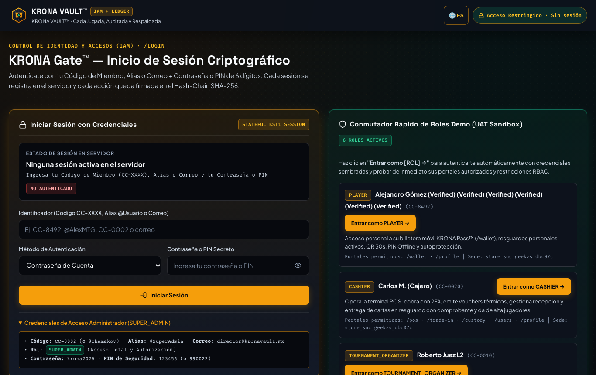
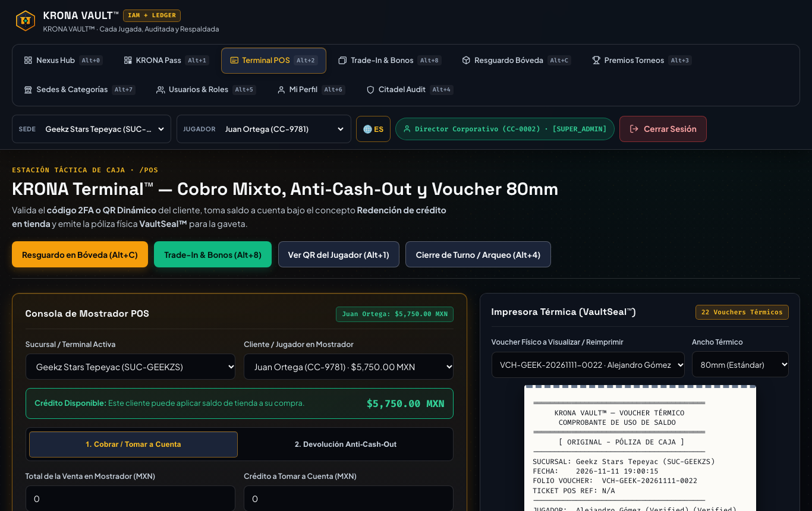
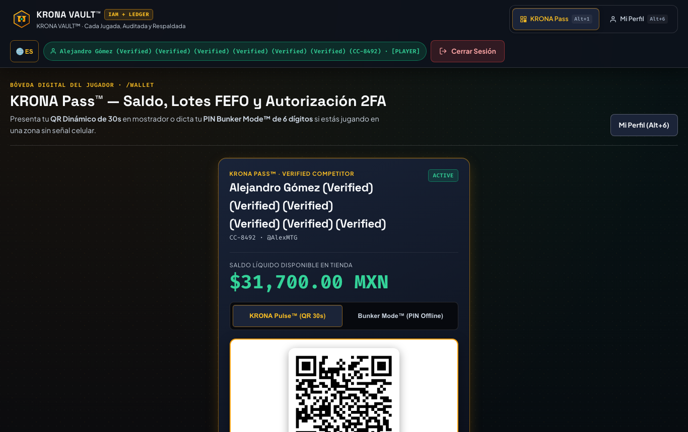
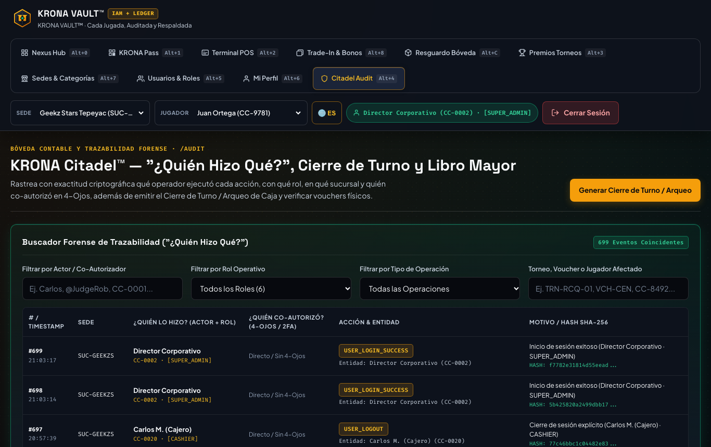
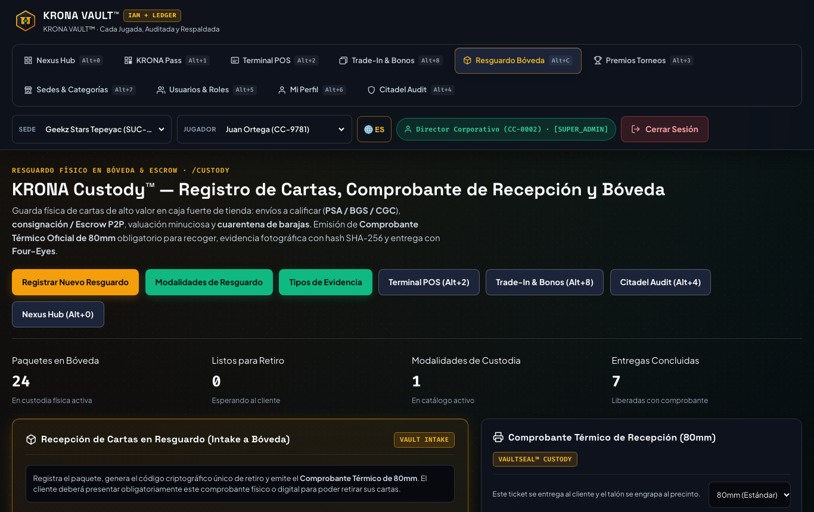
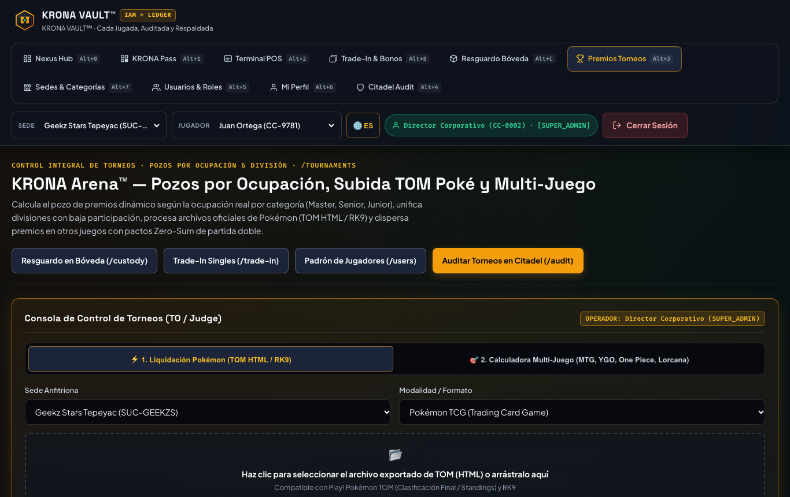
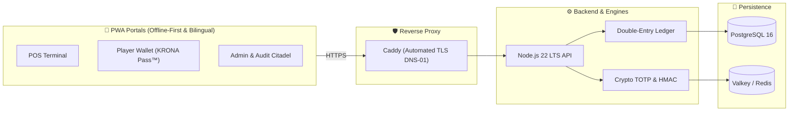

# KRONA VAULT™

[](https://github.com/chamakov/krona-vault/actions/workflows/ci.yml)
[](https://nodejs.org/)
[](https://www.typescriptlang.org/)
[](./LICENSE)
[](./docker-compose.yml)
[](./playwright.config.ts)

> 🌐 **Languages / Idiomas**: [ 🇺🇸 English ](./README.md) · [ 🇲🇽 Español ](./README.es.md)

**KRONA VAULT™** is an institutional-grade, self-hosted fintech platform (ready for **Proxmox VE + Docker Compose** or **Edge Serverless**) designed for the accounting, operational, and cryptographic tracking of **store credit**, thermal POS receipt printing with anti-counterfeiting seals, tournament prize pool distribution, collectible card custody/escrow, and offline 2FA authorization.

---

## 📸 Visual Tour & Portals in Action

| **Nexus Command Hub** (`/`) | **POS Checkout Terminal** (`/pos`) |
| :---: | :---: |
| [](./docs/assets/screenshots/nexus-hub.png) | [](./docs/assets/screenshots/pos-terminal.png) |
| *Central operations command center with quick role routing* | *Counter checkout terminal with mixed-tender & thermal printing* |

| **Player KRONA Pass™ PWA** (`/wallet`) | **Citadel Forensic Audit** (`/audit`) |
| :---: | :---: |
| [](./docs/assets/screenshots/wallet-pass.png) | [](./docs/assets/screenshots/citadel-audit.png) |
| *Real-time player balance, FEFO credits & offline 2FA PIN* | *Cryptographic ledger hash-chain & Corte Z register closure* |

| **Vault Custody™ & Escrow** (`/custody`) | **Tournament Arena** (`/tournaments`) |
| :---: | :---: |
| [](./docs/assets/screenshots/custody-vault.png) | [](./docs/assets/screenshots/tournaments-arena.png) |
| *Dual-custody escrow, locker assignment & tamper seals* | *Zero-sum prize pool calculations & division payouts* |

---

## ⚡ Why KRONA VAULT™?

Traditional Point of Sale platforms (Shopify, Square, Lightspeed, Clover) were architected for generic retail selling coffee or apparel. When deployed in modern **Hobby & Trading Card Game (TCG) Stores**, they create massive operational blind spots, balance discrepancies, and unnecessary fee drag:

| Capability | Generic POS (Square / Shopify / Lightspeed) | KRONA VAULT™ |
| :--- | :--- | :--- |
| **Store Credit Transaction Fees** | 2.6% – 3.5% + $0.30 per "gift card" transaction | **0.0% processing fees** (100% self-hosted & self-cleared) |
| **Accounting Integrity** | Single-entry balances (susceptible to desync & corruption) | **Strict Double-Entry Ledger** ($\sum \text{Debit} = \sum \text{Credit}$) |
| **Tamper-Evident Receipts** | Plain thermal receipts easily reprinted or forged | **Cryptographic Verification Seals (`XXXX-XXXX-XXXX-XXXX`)** & reprint watermarking |
| **Fraud & Rogue Employee Prevention** | Cashier can manually edit balances with zero friction | **Offline 2FA (TOTP + Bunker PIN)** & **Four-Eyes Maker-Checker** |
| **Tournament Prize Dispersion** | Manual spreadsheet calculations & tedious line-by-line crediting | **Automated Zero-Sum Dispersion Engine** with penny-perfect rounding |
| **High-End Card Escrow** | Informal binder holding with zero audit trail | **Vault Custody™** with SHA-256 photo evidence & dual-party signoff |
| **Offline Reliability** | Fails or blocks redemptions during local network outages | **Offline-First PWA** + 6-digit cryptographic TOTP Bunker Mode |

### 🎯 Real-World Use Cases
1. **Local Game Stores (LGS)**: Stop store credit shrinkage, eliminate internal staff balance tampering, and print verifiable receipts for every transaction.
2. **Regional Tournaments & Conventions**: Calculate and disperse prize pools to 100+ players across multiple divisions (Master, Senior, Junior) in seconds, without accounting discrepancies.
3. **High-Value Collectibles & Trade-Ins**: Safely manage trades and consignments of high-end items ($1,000+ graded cards) with digital lockboxes and dual-custody verification.

---

## 📑 Table of Contents

- [Visual Tour & Portals in Action](#-visual-tour--portals-in-action)
- [Why KRONA VAULT™?](#-why-krona-vault)
- [Key Features](#-key-features)
- [System Architecture](#-system-architecture)
- [Included Web Portals (PWA)](#-included-web-portals-pwa)
- [Quick Start](#-quick-start)
  - [Option A: Docker Compose (Recommended)](#option-a-docker-compose-recommended)
  - [Option B: Local Development with Node.js](#option-b-local-development-with-nodejs)
- [Monorepo Structure](#-monorepo-structure)
- [Automated Testing & Quality](#-automated-testing--quality)
- [Technical Documentation](#-technical-documentation)
- [How to Contribute](#-how-to-contribute)
- [Security Policy](#-security-policy)
- [License](#-license)

---

## 🌟 Key Features

### 1. ⚖️ Immutable Double-Entry Accounting Ledger
- PostgreSQL 16 database with triggers that prevent `UPDATE` and `DELETE`, strictly enforcing that **$\sum \text{Debit} = \sum \text{Credit}$** on every transaction entry.
- Cryptographic audit trail chained with `SHA-256` (`prev_hash` + `row_hash`) and sealed with server-side HMAC.
- Strict **FEFO** (*First-Expiring, First-Out*) burn priority, consuming promotional/expiring credit balances before non-expiring store credit.

### 2. 🖨️ Thermal POS Receipt Printing (58mm / 80mm)
- Operates alongside your existing point-of-sale terminal.
- Every credit redemption (full or split tender) produces a physical receipt with sequential folio (`VCH-STORE-YYYYMMDD-XXXX`), balance breakdown, 2FA method, and a **Cryptographic Verification Seal (`XXXX-XXXX-XXXX-XXXX`)**.
- **Anti-Duplicate Reprint Protection**: First print is watermarked as `[ ORIGINAL - POLIZA DE CAJA ]`; subsequent reprints increment `printCount`, trigger forensic audit logging, and print `*** COPIA REIMPRESA #N - NO VALIDA ARQUEO ***`.

### 3. 🔐 Transactional 2FA Authorization & Four-Eyes Principle
- **Dynamic TOTP QR (KRONA Pulse™)**: Rotates every 30 seconds with unique cryptographic nonce to block screenshot replay attacks.
- **6-Digit Offline PIN ("Bunker Mode")**: Allows players to authorize redemptions from their smartphone even with zero cellular or Wi-Fi connectivity inside the venue.
- **Four-Eyes / Maker-Checker Controls**: Manual adjustments over threshold and custody releases require co-signing by a second supervisor, with self-authorization strictly prohibited (`actorUserId !== targetUserId`).

### 4. 🏆 Tournament Prize Pool Engine & Zero-Sum Splits
- Automated prize pool calculations by attendance tiers and age divisions (Master, Senior, Junior).
- Support for Top Cut equity splits with strict zero-sum integrity and residual penny distribution.
- Direct parser for official standings (e.g. Pokémon TOM / RK9).

### 5. 📦 Vault Custody™ & Collectible Escrow
- Secure intake of cards and collectibles deposited as trade-in or escrow.
- Association of photo evidence verified via `SHA-256` content hashing.
- Bilateral custody flows (depositor vs. designated recipient) with tamper-evident seal verification and Four-Eyes release.

### 6. 🌐 Multi-Store & Federated Branches
- Configurable for single corporate entities (`ORG_POOLED_SAME_ENTITY`), automated inter-branch clearing (`INTER_STORE_CLEARING` with Accounts Receivable `1201` and Accounts Payable `2201`), or isolated mode (`STORE_ISOLATED`).

---

## 🏛️ System Architecture



---

## 🖥️ Included Web Portals (PWA)

The platform provides 11 portals accessible from any desktop or mobile browser, fully installable as an offline-first PWA with a built-in Spanish/English language switcher:

| Portal | Route | Description |
| :--- | :--- | :--- |
| **POS Terminal** | `/pos` | Counter terminal for mixed-tender checkout, QR/PIN validation, and thermal receipt printing. |
| **Player Wallet** | `/wallet` | Balance lookup, ledger transaction history, rotating QR (KRONA Pulse™), and offline PIN generator. |
| **Tournaments** | `/tournaments` | Tournament registration, division prize pool calculator, and zero-sum prize dispersion. |
| **Trade-In** | `/trade-in` | Singles intake and valuation in exchange for store credit. |
| **Vault Custody** | `/custody` | Lockbox assignment, tamper-evident seals, photographic intake, and Four-Eyes safe release. |
| **Citadel Audit** | `/audit` | Immutable hash-chain inspection, reprint audit logs, and register closure reports (Corte Z). |
| **Store Management** | `/stores` | Multi-branch registration, category catalog customization, and policy management. |
| **Users & IAM** | `/users` | Role-Based Access Control (RBAC) and staff management across 6 system tiers. |
| **My Profile** | `/profile` | Password change, transaction PIN update, and RFC 6238 Authenticator enrollment. |
| **Login** | `/login` | High-security authentication protected by scrypt password hashing. |
| **Nexus Hub** | `/` | Central command dashboard with role-tailored quick actions. |

---

## 🚀 Quick Start

### Option A: Docker Compose (Recommended)

Ideal for production VPS, Proxmox VE, or full local staging:

1. **Clone the repository**:
   ```bash
   git clone https://github.com/chamakov/krona-vault.git
   cd krona-vault
   ```

2. **Configure environment variables**:
   ```bash
   cp .env.example .env
   ```
   *(Review [docs/ENVIRONMENT_VARIABLES.md](./docs/ENVIRONMENT_VARIABLES.md) to generate production-grade cryptographic keys).*

3. **Start services**:
   ```bash
   docker compose up -d --build
   ```

4. **Access the application**:
   Open [http://localhost:3000](http://localhost:3000) in your web browser.

---

### Option B: Local Development with Node.js

Prerequisites: **Node.js >= 22.23.4** and **npm >= 10.9.9**.

1. **Install monorepo dependencies**:
   ```bash
   npm ci
   ```

2. **Run test suites**:
   ```bash
   npm test
   ```

3. **Start development API server**:
   ```bash
   npm run dev:api
   ```
   The server will listen at `http://localhost:3000`.

---

## 📦 Monorepo Structure

```
krona-vault/
├── apps/
│   ├── api/             # HTTP server, double-entry engine, REST API & Cloudflare Worker
│   └── web-pwa/         # 11 bilingual, offline-first PWA portals (Vanilla JS + CSS)
├── packages/
│   ├── crypto-totp/     # TOTP, HMAC-SHA256, Base32 RFC 4648, scrypt & audit chaining
│   └── shared-types/    # Shared TypeScript contracts and ledger interfaces
├── infra/
│   ├── caddy/           # Caddyfile reverse proxy with automated DNS-01 TLS
│   └── postgres/        # init.sql with immutable double-entry triggers
├── docs/                # Architecture design specs, assets, and deployment guides (EN/ES)
├── e2e/                 # End-to-end browser test suites with Playwright
├── scripts/             # Backup automation and maintenance scripts
└── docker-compose.yml   # Multi-container service orchestration
```

---

## 🧪 Automated Testing & Quality

KRONA VAULT enforces comprehensive test coverage across all layers:

```bash
# Strict TypeScript validation across all workspaces
npm run typecheck

# Unit and integration tests (ledger invariants, cryptography, REST API)
npm test

# Full End-to-End browser test suite on Playwright (Chromium)
npm run test:e2e
```

---

## 📚 Technical Documentation

- 📖 [System Architecture & Cryptographic Design](./docs/ARCHITECTURE.md) (or [Versión en Español](./docs/ARCHITECTURE.es.md))
- 🚀 [Deployment Guide (Docker, Proxmox VE, Cloudflare)](./docs/DEPLOYMENT.md) (or [Versión en Español](./docs/DEPLOYMENT.es.md))
- ⚙️ [Environment Variables Reference](./docs/ENVIRONMENT_VARIABLES.md) (or [Versión en Español](./docs/ENVIRONMENT_VARIABLES.es.md))

---

## 🤝 How to Contribute

Contributions are welcome! Please check our [Contributing Guide](./CONTRIBUTING.md) (or [Guía en Español](./CONTRIBUTING.es.md)) and [Code of Conduct](./CODE_OF_CONDUCT.md).

---

## 🛡️ Security Policy

To report security vulnerabilities responsibly, please review our [Security Policy](./SECURITY.md) (or [Política en Español](./SECURITY.es.md)).

---

## 📄 License

This project is licensed under the **MIT License**. See the [LICENSE](./LICENSE) file for details.
