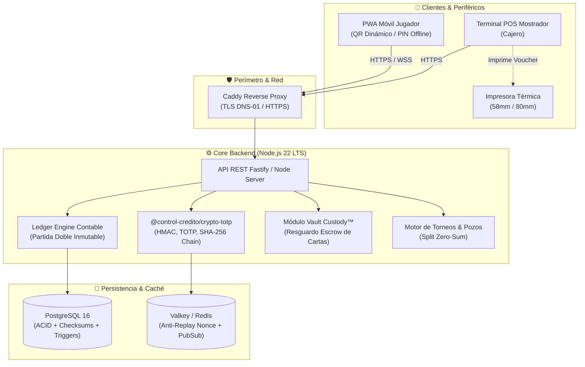

# Arquitectura Técnica — Control Crédito

Este documento detalla los componentes de software, el diseño de seguridad criptográfica, las invariantes contables y los flujos operativos de **Control Crédito**.

---

## 🏗️ Diagrama General del Sistema

---

## 📦 Paquetes y Módulos del Monorepo

| Paquete / Carpeta | Tipo | Responsabilidad |
| :--- | :--- | :--- |
| `packages/crypto-totp` | Librería TS | Generación y verificación de QR dinámico TOTP, PIN offline, Base32 RFC 4648, hashing scrypt y encadenamiento de auditoría forense SHA-256. |
| `packages/shared-types` | Librería TS | Interfaces y tipos compartidos para transacciones, cuentas contables, vouchers, pólizas y roles RBAC. |
| `apps/api` | Servicio | Endpoints REST, orquestación de transacciones contables, integración con PostgreSQL / D1 y validación de reglas de negocio. |
| `apps/web-pwa` | PWA Vanilla | 11 portales web responsivos con soporte offline y diseño corporativo de alta densidad para mostradores POS. |
| `infra/` | Infraestructura | Archivos Caddyfile y scripts SQL de inicialización con triggers contables. |

---

## ⚖️ Motor Contable por Partida Doble (Double-Entry Ledger)

El sistema opera bajo los estándares de contabilidad financiera:

### Invariante Fundamental
En todo evento económico registrado en el sistema, la suma de los débitos debe ser exactamente igual a la suma de los créditos:
$$\sum \text{Debe} = \sum \text{Haber}$$

### Plan de Cuentas Preconfigurado
- **Activo**:
  - `1101` Caja y Efectivo en Mostrador
  - `1201` Cuentas por Cobrar Inter-Sucursal
- **Pasivo**:
  - `2101` Saldo de Crédito a Favor de Jugadores (Pasivo Exigible)
  - `2102` Crédito Promocional / Preventas en Escrow
  - `2201` Cuentas por Pagar Inter-Sucursal
- **Capital y Resultados**:
  - `4101` Ingresos por Cuotas de Torneos
  - `5101` Costo de Premiación y Descuentos Otorgados

### Inmutabilidad a Nivel Base de Datos
La tabla de asientos contables prohíbe operaciones `UPDATE` y `DELETE` mediante *triggers* de PostgreSQL. Si un asiento debe corregirse o cancelarse, el sistema emite un asiento de contrapartida o ajuste auditado.

---

## 🧾 Vouchers Físicos Térmicos y Control Anti-Fraude

Cada operación de cobro o redención emite una póliza física para impresora térmica (58mm o 80mm):
1. **Folio Único Secuencial**: Formato `VCH-{STORE}-{YYYYMMDD}-{FOLIO}`.
2. **Sello Criptográfico**: Hash de 16 caracteres (`XXXX-XXXX-XXXX-XXXX`) generado a partir de los datos de la transacción y la clave secreta del servidor.
3. **Control de Reimpresión**:
   - Primera impresión: Marcada como `[ ORIGINAL - POLIZA DE CAJA ]`.
   - Reimpresiones subsecuentes: Incrementan el contador `printCount`, quedan registradas en la auditoría forense e imprimen la leyenda `*** COPIA REIMPRESA #N - NO VALIDA ARQUEO ***`.

---

## 🔐 Autorización de Dos Pasos (2FA Transaccional Dual)

1. **Escaner QR Dinámico TOTP**:
   - Rota cada 30 segundos.
   - Incluye un *nonce* criptográfico único para evitar ataques de captura de pantalla (*screenshot replay*).
2. **PIN Offline de 6 Dígitos ("Modo Sótano")**:
   - Si la tienda o el local no tiene cobertura celular o WiFi, la PWA del jugador genera un PIN TOTP offline válido de un solo uso.
3. **Principio de Cuatro Ojos (Four-Eyes / Maker-Checker)**:
   - Acciones que superan los límites de política (ajustes manuales de saldo, desprecinto de cartas de alto valor en custodia) exigen la co-autorización y PIN de un segundo supervisor, impidiendo la auto-aprobación (`actorUserId !== approverUserId`).
