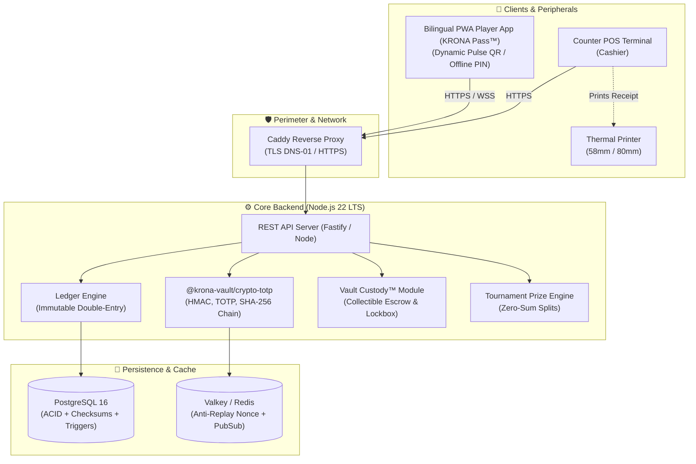

# Technical Architecture & Cryptographic Design — KRONA VAULT™

> 🌐 **Languages / Idiomas**: [ 🇺🇸 English ](./ARCHITECTURE.md) · [ 🇲🇽 Español ](./ARCHITECTURE.es.md)

This document provides a comprehensive overview of the software components, cryptographic primitives, accounting invariants, and operational workflows of **KRONA VAULT™**.

---

## 🏗️ High-Level System Architecture

---

## 📦 Monorepo Packages

| Package / Directory | Type | Responsibility |
| :--- | :--- | :--- |
| `packages/crypto-totp` | TS Library | Dynamic TOTP QR generation, 6-digit offline PIN, Base32 RFC 4648, scrypt hashing, and SHA-256 forensic audit chaining. |
| `packages/shared-types` | TS Library | Common TypeScript types and interfaces for transactions, accounts, vouchers, policies, and RBAC roles. |
| `apps/api` | Service | REST endpoints, double-entry transaction coordination, PostgreSQL / Cloudflare D1 integration, and domain rule validation. |
| `apps/web-pwa` | PWA Frontend | 11 bilingual, offline-first responsive web portals with high-density layouts for POS stations. |
| `infra/` | Infrastructure | Caddy reverse proxy Caddyfile and PostgreSQL init scripts with database-level triggers. |

---

## ⚖️ Double-Entry Ledger Principles

The platform follows rigorous financial accounting standards:

### Fundamental Invariant
For every financial event recorded by the system, total debits must equal total credits:
$$\sum \text{Debit} = \sum \text{Credit}$$

### Chart of Accounts
- **Assets (1000s)**:
  - `1101` Cash on Hand (Counter Register)
  - `1201` Accounts Receivable (Inter-Branch Clearing)
- **Liabilities (2000s)**:
  - `2101` Customer Store Credit Balances (Current Liability)
  - `2102` Promotional Credit / Pre-Order Escrow
  - `2201` Accounts Payable (Inter-Branch Clearing)
- **Equity & Income (4000s / 5000s)**:
  - `4101` Tournament Entry Fee Revenues
  - `5101` Prize Dispersion Costs & Promotional Discounts

### Database-Level Immutability
The transaction journal prohibits direct `UPDATE` and `DELETE` operations via PostgreSQL triggers. Corrections require explicit, audited counter-entries.

---

## 🧾 Thermal Physical Receipts & Anti-Fraud Seals

Every checkout redemption prints an auditable physical slip (58mm or 80mm):
1. **Sequential Unique Folio**: Format `VCH-{STORE}-{YYYYMMDD}-{FOLIO}`.
2. **Cryptographic Seal**: 16-character HMAC token (`XXXX-XXXX-XXXX-XXXX`) derived from transaction details and server secret.
3. **Reprint Detection**:
   - Initial print: Marked as `[ ORIGINAL - POLIZA DE CAJA ]`.
   - Subsequent prints: Increments `printCount`, emits an audit log event, and prints `*** COPIA REIMPRESA #N - NO VALIDA ARQUEO ***`.

---

## 🔐 Dual-Layer 2FA & Four-Eyes Principle

1. **Dynamic TOTP QR (KRONA Pulse™)**:
   - Rotates every 30 seconds.
   - Embeds a single-use cryptographic nonce to prevent screenshot replay attacks.
2. **6-Digit Offline PIN ("Bunker Mode")**:
   - Computes deterministic RFC 6238 TOTP codes locally on the player's smartphone, valid even when local cellular signals fail.
3. **Four-Eyes Verification (Maker-Checker)**:
   - Actions exceeding risk thresholds (high-value adjustments, lockbox card release) require secondary supervisor co-signature and PIN, preventing self-approval (`actorUserId !== approverUserId`).
