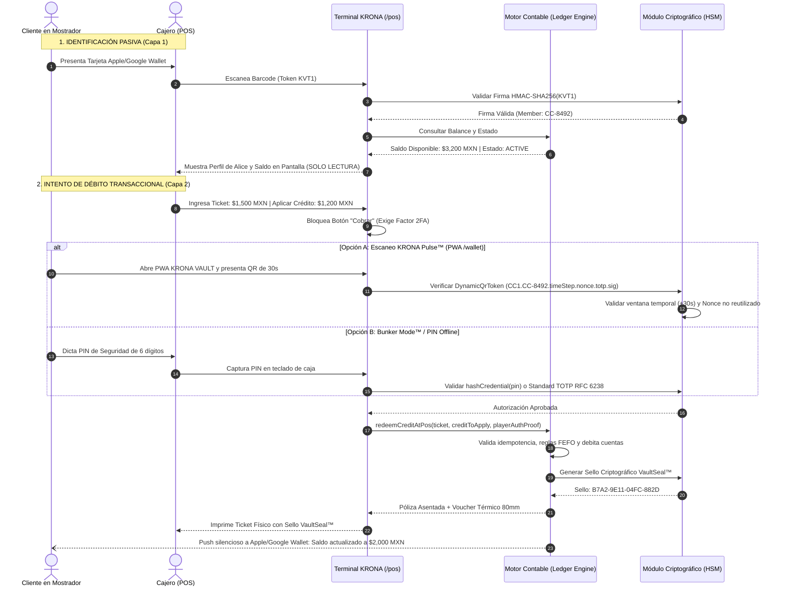
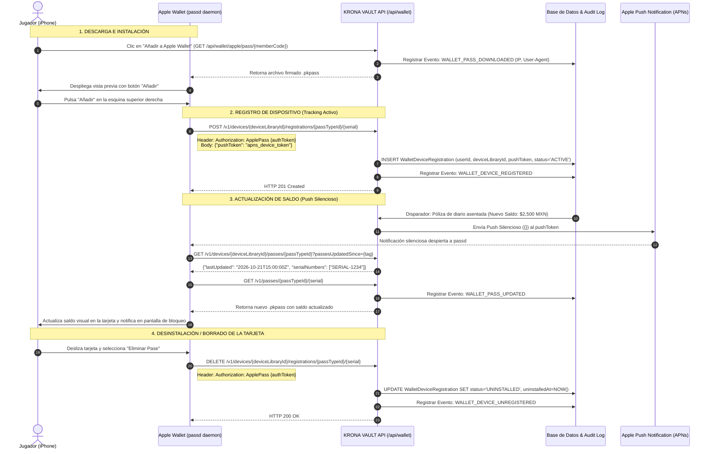

# KRONA VAULT — Seguridad, Criptografía, Prevención de Fraude y Dinámica QR/NFC en Apple Wallet y Google Wallet

**Versión:** 1.0.0  
**Fecha:** 2026-10-21  
**Estado:** Documento de Arquitectura y Especificación Criptográfica Oficial  
**Alcance:** Monorepo `controlCredito` (`packages/shared-types`, `packages/crypto-totp`, `apps/api`, `apps/web-pwa`, `infra/postgres`)  
**Autor:** Antigravity Architect Squad / KRONA VAULT Core Team  

---

## 1. Resumen Ejecutivo y Marco Arquitectónico

La digitalización de credenciales de jugador para tiendas de juegos de cartas coleccionables (TCG - *Magic: The Gathering, Pokémon, Yu-Gi-Oh!, One Piece, Lorcana*) mediante billeteras móviles nativas (**Apple Wallet** en iOS/watchOS y **Google Wallet** en Android/WearOS) abre oportunidades extraordinarias de engagement, fidelización y agilidad operativa en mostrador.

No obstante, en un entorno donde las carteras de crédito digital de los jugadores manejan montos considerables (derivados de premios de torneos, *Trade-In* de cartas de alto valor y abonos en efectivo), el uso indiscriminado de tarjetas de fidelidad estándar genera **vulnerabilidades críticas de fraude**.

### 1.1. La Declaración Arquitectónica Principal

> **"Un pase nativo de Apple o Google Wallet es una credencial de IDENTIDAD Y PRESENCIA, no un cheque al portador ni una llave transaccional de débito no supervisada."**

Para resolver el requerimiento de negocio (*"de tal manera que podamos trackearlo desde ahí"* y proteger el saldo contra capturas de pantalla maliciosas), KRONA VAULT establece una **Arquitectura de Seguridad Dual en Dos Planos**:

```
 ┌────────────────────────────────────────────────────────────────────────┐
 │                      KRONA VAULT DUAL ARCHITECTURE                     │
 └────────────────────────────────────────────────────────────────────────┘
          │                                              │
          ▼                                              ▼
┌─────────────────────────────────┐            ┌──────────────────────────────────┐
│  PLANO 1: IDENTIDAD Y PRESENCIA │            │ PLANO 2: AUTORIZACIÓN Y DÉBITO   │
│   (Apple Wallet / Google Wallet)│            │      (KRONA VAULT PWA / 2FA)     │
├─────────────────────────────────┤            ├──────────────────────────────────┤
│ • Identificación del jugador    │            │ • Validación criptográfica TOTP  │
│ • Check-in a torneos TCG        │            │ • KRONA Pulse™ (QR de 30s)       │
│ • Recepción de cartas (Custody) │            │ • Bunker Mode™ (PIN Offline)     │
│ • Saldo visible en Lock Screen  │            │ • Autorización explícita de caja │
│ • Geofencing / Push Silencioso  │            │ • Póliza en Ledger Contable      │
│ • Trazabilidad de Dispositivos  │            │ • Sello Térmico VaultSeal™       │
└─────────────────────────────────┘            └──────────────────────────────────┘
```

---

## 2. El Gran Dilema Técnico: ¿Puede un Pase Nativo Rotar un QR Dinámico TOTP cada 30 Segundos?

Una de las preguntas más recurrentes al diseñar pases digitales de seguridad bancaria es si es posible replicar la experiencia de **KRONA Pulse™** (código QR rotatorio cada 30 segundos mediante TOTP determinista) directamente dentro de la tarjeta de Apple Wallet o Google Wallet.

La respuesta técnica categórica es: **NO a través de la tarjeta nativa, y cualquier intento de forzarlo mediante empuje remoto (push) es inviable y peligroso.**

A continuación se expone la justificación técnica profunda desglosada por plataforma:

### 2.1. Análisis Técnico de Apple Wallet (PassKit Framework / iOS)

1. **Naturaleza Estática del Contenedor `.pkpass`:**
   - Un pase de Apple Wallet es físicamente un archivo comprimido en formato ZIP con extensión `.pkpass` que contiene:
     - `pass.json`: Definición declarativa de campos de texto, colores, metadatos y configuración del código de barras.
     - `manifest.json`: Mapa SHA-1 de todos los archivos del archivo.
     - `signature`: Firma PKCS#7 / CMS detached generada exclusivamente con el certificado emitido por Apple (*Pass Type ID Certificate*) y su clave privada RSA.
     - Recursos gráficos fijos (`icon.png`, `logo.png`, `strip.png`).
   - **Restricción de Sandbox:** PassKit se ejecuta bajo el daemon centralizado del sistema operativo iOS denominado `passd`. Apple Wallet **NO** es un navegador, no interpreta HTML/CSS dinámico, no cuenta con un motor V8/JavaScriptCore accesible y **carece absolutamente de primitivas para ejecutar código local (JavaScript, Swift o WebAssembly) dentro del visor de tarjetas**.

2. **Estructura Declarativa del Código de Barras en `pass.json`:**
   ```json
   "barcodes": [
     {
       "format": "PKBarcodeFormatQR",
       "message": "KVT1.CC-8492.e8a2f1c0.a3d7e5b291c4",
       "messageEncoding": "iso-8859-1",
       "altText": "Socio: CC-8492"
     }
   ]
   ```
   El atributo `message` es una cadena fija en el archivo binario firmado.

3. **Inviabilidad Matemática y Operativa de la Actualización Remota (APNs Push):**
   Para modificar el campo `message` de un código de barras en Apple Wallet desde la nube, el sistema debe seguir el protocolo obligatorio de PassKit:
   - **Paso A:** El servidor envía una notificación push APNs silenciosa (`payload: {}`) dirigida al `pushToken` del dispositivo.
   - **Paso B:** El daemon `passd` de iOS despierta en segundo plano y realiza una petición HTTPS:
     `GET {webServiceURL}/v1/devices/{deviceLibraryIdentifier}/passes/{passTypeIdentifier}?passesUpdatedSince={tag}`
   - **Paso C:** iOS compara seriales y realiza una segunda petición HTTPS para descargar el nuevo pase completo:
     `GET {webServiceURL}/v1/passes/{passTypeIdentifier}/{serialNumber}`
   - **Paso D:** El servidor de KRONA debe reconstruir el JSON, regenerar el `manifest.json`, firmar digitalmente con OpenSSL/PKCS#7 y enviar el archivo binario `.pkpass` (de ~50 KB a 150 KB).

   **Factores que Destruyen este Enfoque para una Ventana de 30 Segundos:**
   - **Latencia de Red Asíncrona:** APNs no ofrece garantías de entrega en tiempo real sub-segundo para notificaciones silenciosas de baja prioridad. Un push silencioso de PassKit típicamente tarda entre 3 y 45 segundos en despertar el dispositivo, haciendo matemáticamente imposible garantizar que el QR mostrado coincida con la ventana de tiempo del servidor.
   - **Rate Limiting y Baneo de APNs:** Apple implementa políticas estrictas de throttling (*Push Coalescing*). Enviar 1 push cada 30 segundos equivale a **2,880 notificaciones push por día por cada usuario activo**, más 5,760 peticiones HTTP y ~350 MB de transferencia de datos por pase al día. Apple detectará este patrón como abuso de infraestructura y revocará el certificado del Pass Type ID.
   - **Impacto Térmico y Drenaje Catastrófico de Batería:** Mantener el subsistema celular/Wi-Fi del iPhone en estado activo permanente (`High Power State`) drena la batería del cliente en pocas horas.
   - **Fallas en Zonas sin Cobertura (Salones de Juego y Sótanos):** Si el jugador ingresa a un sótano o a una convención con señal celular degradada, el pase quedará congelado con el último QR recibido (el cual expirará en 30 segundos), dejando al jugador totalmente imposibilitado para identificarse o participar.

### 2.2. Análisis Técnico de Google Wallet (Google Play Services / Android)

1. **Modelo de Objetos en la Nube (Google Wallet REST API):**
   - En Google Wallet, una tarjeta de cliente se compone de una clase (`LoyaltyClass`) y una instancia (`LoyaltyObject`).
   - El código de barras se define en la estructura del objeto:
     ```json
     "barcode": {
       "type": "QR_CODE",
       "value": "KVT1.CC-8492.e8a2f1c0.a3d7e5b291c4",
       "alternateText": "KRONA ID: CC-8492"
     }
     ```
   - Google Wallet no permite ejecución de JavaScript de terceros en el cliente Android.
   - Para actualizar el valor del código de barras, el backend debe enviar una solicitud HTTP PATCH a:
     `PATCH https://walletobjects.googleapis.com/walletobjects/v1/loyaltyObject/{id}` autenticado mediante una Service Account OAuth2 de Google Cloud.
   - Luego, los servidores de Google envían la actualización al dispositivo del usuario a través de Firebase Cloud Messaging (FCM).

2. **Restricciones de Cuota de Google Cloud y Concurrencia:**
   - Google Wallet API impone límites estrictos de cuota (QPS - Queries Per Second) por Service Account.
   - Actualizar miles de objetos concurrentemente cada 30 segundos colapsa la cuota de la API y genera retardos masivos de sincronización en Google Play Services.

3. **Nota de Especialista sobre "Rotating Barcodes" en Google Wallet:**
   Google Wallet cuenta con una funcionalidad denominada *Rotating Barcode* (TOTP nativo del lado del cliente de Play Services), pero:
   - Está **estrictamente restringida a socios enterprise de transporte público o boletaje masivo de eventos** (ej. Ticketmaster SafeTix™) bajo convenios comerciales cerrados.
   - No está habilitada para objetos genéricos o de lealtad (`LoyaltyObject` / `GenericObject`) para desarrolladores generales.
   - **Asimetría Crítica:** Aunque estuviera disponible en Google Wallet, en Apple Wallet no existe un homólogo público para pases comerciales, lo que crearía una arquitectura fracturada e insegura entre los usuarios de iOS y Android.

---

## 3. Arquitectura de Seguridad Dual: Identidad vs. Autorización Transaccional

Dado que la rotación local cada 30 segundos en billeteras nativas es técnicamente inviable e insegura, la solución correcta de ingeniería de software es la **Separación Criptográfica de Funciones**:

### 3.1. Capa 1: Pase Nativo de Wallet (Apple / Google) — Identidad y Presencia

El pase nativo sirve para identificar al jugador en milisegundos, registrar su asistencia y mantenerlo informado, sin otorgarle capacidad de débito unilateral.

#### A. Casos de Uso del Pase Nativo
1. **Identificación Rápida en Mostrador:** El cajero escanea el pase y de inmediato el sistema carga el perfil, fotografía, membrecía y balance contable del jugador en pantalla.
2. **Check-In Express a Torneos:** Los organizadores y jueces pueden escanear el QR del pase en la entrada para confirmar la presencia del jugador en el torneo de la tarde sin filas ni tecleo manual.
3. **Recepción de Cartas para Resguardo (*Intake Custody*):** Apertura de expedientes en `/custody` para calificar cartas en PSA o dejarlas en consignación vinculadas al código de miembro.
4. **Consulta de Saldo en Pantalla de Bloqueo:** Notificaciones de saldo actualizadas mediante pushes silenciosos cada vez que se asienta una póliza en el Ledger (eventos esporádicos y legítimos, no cada 30 segundos).
5. **Geolocalización Contextual (iBeacon / Geofencing GPS):** Cuando el jugador se acerca físicamente a cualquiera de las sucursales de la tienda, la tarjeta de KRONA VAULT se ilumina automáticamente en su pantalla de bloqueo con un solo toque.

#### B. Estructura Criptográfica del Token de Miembro (`KVT1`)
Para evitar que un atacante genere códigos QR falsos o deduzca los identificadores de otros jugadores, el QR del pase nativo **NO contiene el `userId` o número secuencial en texto plano**.

Se define el estándar **KRONA Vault Token v1 (`KVT1`)**:

```
KVT1.<memberCode>.<cardSaltHex>.<signatureHex>
```

- **`KVT1`**: Prefijo de versión del protocolo.
- **`memberCode`**: Código legible y canónico del jugador (ej. `CC-8492` o UUID).
- **`cardSaltHex`**: Semilla aleatoria de 8 bytes (16 caracteres hex) generada por el servidor durante la emisión de la tarjeta y guardada en el registro de la billetera.
- **`signatureHex`**: Firma criptográfica HMAC-SHA256 truncada a 24 caracteres hex generada por el HSM del servidor:
  $$\text{signatureHex} = \text{HMAC-SHA256}(\text{SERVER\_HSM\_SECRET}, \text{"KVT1|" + memberCode + "|" + cardSaltHex})[0..24]$$

#### C. Ventajas Criptográficas de `KVT1`:
- **Infalsificabilidad:** Es imposible crear un código válido sin poseer la clave privada del servidor (`SERVER_HSM_SECRET`).
- **Revocación Instantánea sin Cambiar Membresía:** Si el usuario pierde su teléfono o sospecha de fraude, el administrador hace clic en "Invalidar Pase de Wallet": el sistema genera un nuevo `cardSaltHex`, lo cual deja inmediatamente inservible el código anterior sin alterar el historial contable ni el `memberCode` del socio.

---

### 3.2. Capa 2: Autorización de Débito y Consumo en Caja POS (`/pos`)

#### El Vector de Ataque: Fraude por Captura de Pantalla Compartida (The Screenshot Sharing Fraud)

```
[Jugador Malicioso "Alice"] ──── Captura de Pantalla de Apple Wallet ────> [Amigo "Bob"]
(Tiene $5,000 MXN de crédito)                                              (Va a la tienda)
                                                                                  │
                                                                         Presenta captura
                                                                         en el mostrador
                                                                                  ▼
                                                                        [Caja /pos de KRONA]
```

Si el cajero simplemente escaneara el QR del pase nativo y descontara saldo, **Bob podría gastar los $5,000 MXN de Alice sin su consentimiento presente**, o Alice podría fingir un robo alegando que la tienda cobró a una captura no autorizada (*Friendly Fraud / Chargeback Abuse*).

#### El Protocolo Cero-Confianza (Zero-Trust) en KRONA VAULT POS:



---

## 4. Trazabilidad y Detección de Instalación / Desinstalación (Tracking)

Uno de los requerimientos clave es responder a: **"de tal manera que podamos trackearlo desde ahí"**.

¿Cómo sabe exactamente el sistema KRONA VAULT si el jugador tiene su tarjeta instalada en su iPhone o en su Android, o si la desinstaló?

### 4.1. El Protocolo REST de Apple PassKit Web Service

Apple Wallet implementa una especificación REST estándar y rigurosa en el sistema operativo iOS. Cuando un usuario interactúa con un pase, iOS realiza las siguientes llamadas automáticas contra el backend de KRONA VAULT:



### 4.2. Trazabilidad en Google Wallet

En Google Wallet, la vinculación y el rastreo se gestionan mediante:
1. **Google Wallet Save JWT:** El backend emite un enlace firmado con el `serviceAccountKey` que contiene los identificadores del usuario (`userId`, `memberCode`).
2. **Google Wallet API Webhooks / PubSub:** Cuando el usuario guarda o elimina el objeto en su aplicación de Google Wallet, Google notifica mediante callbacks:
   - `OBJECT_INSERT`: El usuario guardó exitosamente el pase en su dispositivo.
   - `OBJECT_DELETE`: El usuario borró el pase de su billetera.
3. **Sondeo de Estado de Instalación:** El backend puede consultar en cualquier momento a través de la API REST de Google Wallet:
   `GET https://walletobjects.googleapis.com/walletobjects/v1/loyaltyObject/{id}`
   examinando el atributo `hasUsers: true/false`.

### 4.3. Modelo de Datos Relacional para Tracking (`WalletDeviceRegistration`)

Para auditar y monitorear los dispositivos en KRONA VAULT, se implementa la siguiente tabla en PostgreSQL:

```sql
-- Registro de Dispositivos y Billeteras Vinculadas (Apple & Google Wallet)
CREATE TABLE wallet_device_registrations (
    id UUID PRIMARY KEY DEFAULT gen_random_uuid(),
    user_id VARCHAR(64) NOT NULL REFERENCES users(id),
    wallet_platform VARCHAR(16) NOT NULL CHECK (wallet_platform IN ('APPLE_WALLET', 'GOOGLE_WALLET')),
    device_library_identifier VARCHAR(128) NOT NULL, -- Identificador único de hardware en Apple
    pass_serial_number VARCHAR(64) NOT NULL UNIQUE,
    authentication_token VARCHAR(64) NOT NULL,       -- Clave compartida para autenticar peticiones de iOS
    push_token VARCHAR(256),                         -- Token APNs o FCM para updates silenciosos
    device_model VARCHAR(64),                        -- Ej: "iPhone 15 Pro", "Pixel 8"
    is_active BOOLEAN NOT NULL DEFAULT TRUE,
    installed_at TIMESTAMPTZ NOT NULL DEFAULT NOW(),
    last_synced_at TIMESTAMPTZ NOT NULL DEFAULT NOW(),
    uninstalled_at TIMESTAMPTZ,
    
    CONSTRAINT uq_device_pass UNIQUE (device_library_identifier, pass_serial_number)
);

CREATE INDEX idx_wallet_devices_user ON wallet_device_registrations(user_id);
CREATE INDEX idx_wallet_devices_active ON wallet_device_registrations(wallet_platform, is_active);
```

### 4.4. Eventos Forenses en la Cadena de Auditoría (`AuditLogEntry`)

Cada evento del ciclo de vida de la tarjeta móvil se registra como un eslabón inmutable en la cadena de auditoría SHA-256 (`Hash-Chain`) con firma del HSM:

| Acción de Auditoría | Descripción del Evento | Datos Críticos en Payload |
| :--- | :--- | :--- |
| `WALLET_PASS_DOWNLOADED` | Usuario descarga el archivo `.pkpass` o abre el enlace Save de Google | `userId, ipAddress, userAgent, serialNumber` |
| `WALLET_DEVICE_REGISTERED` | Dispositivo iOS o Android envía su token push y se vincula a la cuenta | `deviceLibraryId, platform, pushTokenHash` |
| `WALLET_BALANCE_PUSHED` | Se envió un push silencioso tras un cambio contable en el Ledger | `journalEntryId, oldBalanceCents, newBalanceCents` |
| `WALLET_PASS_UPDATED` | El dispositivo descargó con éxito el pase con el saldo actualizado | `serialNumber, deviceLibraryId, syncLatencyMs` |
| `WALLET_DEVICE_UNREGISTERED` | El jugador eliminó la tarjeta de su Apple Wallet o Google Wallet | `deviceLibraryId, uninstalledAt, remainingBalanceCents` |
| `WALLET_PASS_REVOKED` | Administrador revocó remotamente el pase por sospecha de fraude | `adminUserId, reason, invalidatedSaltHex` |

---

## 5. NFC Value Added Services (Apple VAS & Google Smart Tap)

### 5.1. ¿Qué son Apple VAS y Google Smart Tap?
Son protocolos propietarios basados en la interfaz de proximidad NFC (ISO/IEC 14443 Type A/B) que permiten transmitir pases de lealtad, membresía y boletos simplemente acercando el teléfono al lector de mostrador, **sin necesidad de encender la pantalla ni abrir la aplicación manualmente** (*Express Mode*).

### 5.2. Comparativa Técnica y Requisitos de Hardware en Tienda

| Criterio | Escaneo Óptico QR (KRONA VAULT Actual) | Lector USB ACR122U Estándar | Lector Certificado Apple VAS / Smart Tap (ej. SpringCard Puck / Socket S550) |
| :--- | :--- | :--- | :--- |
| **Costo por Terminal** | $0 USD (Cámara web o lector 2D USB de $30 USD) | ~$45 USD | ~$250 - $450 USD |
| **Compatibilidad con Teléfonos** | 100% de dispositivos iOS y Android | Incompatible con Apple VAS nativo | 100% de dispositivos con NFC |
| **Licenciamiento y Aprobación** | Ninguno (Estándar abierto) | N/A | **Requiere aprobación directa de Apple y Google** |
| **Criptografía en Tránsito** | Token firmado HMAC-SHA256 en barcode | N/A (Solo lee UID o emulación genérica) | Cifrado mutuo de canal con curva elíptica ECDH y AES-128-GCM |
| **Experiencia de Usuario** | El jugador muestra la pantalla (1 a 3 segundos) | Requiere tocar lector (pero no abre el pase nativo) | El jugador solo acerca el iPhone o Apple Watch (< 1 segundo) |

### 5.3. Factibilidad del Lector USB ACR122U en el Mostrador

El lector **ACR122U** es un dispositivo clásico USB CCID diseñado para leer tarjetas inteligentes sin contacto físicas (MIFARE Classic, MIFARE Ultralight, NTAG213/215/216 y FeliCa).
- **Problema de Apple VAS:** Apple Wallet requiere que el lector emita un comando de sondeo propietario denominado **ECP (Enhanced Contactless Polling)** que contiene el *Apple Merchant ID*. El ACR122U convencional no emite secuencias ECP a nivel de chip transceptor de radiofrecuencia (PN532) sin modificaciones de bajo nivel de firmware.
- **Veredicto sobre ACR122U:** No es viable para Apple VAS nativo sin un puente de firmware especializado. Para emular tarjetas físicas (tarjetas de plástico PVC NFC impresas por la tienda), el ACR122U sí funciona perfectamente leyendo el UID físico.

### 5.4. Hoja de Ruta Recomendada de Implementación de Hardware:
- **Fase 1 (Inmediata y Universal):** Mantener el escaneo de código QR (mediante pistola lectora 2D USB conectada a la PC de caja o cámara de la tableta POS). Costo marginal cero y compatible con el 100% de los jugadores.
- **Fase 2 (Flagship Stores):** Incorporar terminales de mostrador certificados con soporte Apple VAS y Google Smart Tap (ej. *SpringCard Puck USB* o terminales *Android POS SUNMI/PAX* con ECP licenciado) para tiendas insignia con alto volumen de torneos.

---

## 6. Matriz de Amenazas y Mitigaciones (Modelo STRIDE)

| Categoría STRIDE | Vector de Amenaza en Tienda TCG | Impacto Potencial | Mitigación Implementada en KRONA VAULT |
| :--- | :--- | :--- | :--- |
| **Spoofing (Suplantación)** | Un cliente malicioso crea un código QR falso con el `memberCode` de un jugador con mucho saldo. | Alto: El cajero podría cargar la cuenta equivocada. | **Firma Criptográfica HMAC-SHA256 (`KVT1`):** El token del pase requiere una firma válida generada con el `SERVER_HSM_SECRET`. Códigos inventados son rechazados al instante por el scanner. |
| **Tampering (Manipulación)** | El cliente edita el archivo `pass.json` de su Apple Wallet para que en pantalla aparezca "$50,000 MXN". | Nulo: Intento de engaño visual. | **Firma PKCS#7 y Consulta al Ledger Central:** Cualquier alteración del archivo invalida la firma de Apple y el iPhone rechaza el pase. Además, el terminal POS **nunca lee el saldo del pase**, sino que consulta en tiempo real al motor de base de datos (`ledger-engine.ts`). |
| **Repudiation (Repudio)** | Un jugador gasta su saldo y luego afirma que él no fue, alegando que alguien le tomó una foto a su tarjeta en la mesa de juego. | Alto: Disputas comerciales y pérdida de confianza. | **Segundo Factor Obligatorio para Débitos:** El QR nativo solo identifica. Para redimir saldo (> $0), se exige PIN de 6 dígitos (*Bunker Mode™*) o QR dinámico de 30s (*KRONA Pulse™*). Ambos factores se auditan en la póliza con sello `VaultSeal™`. |
| **Information Disclosure (Divulgación)** | Un tercero observa el QR del pase en la pantalla de bloqueo del jugador durante un torneo. | Bajo: No expone datos sensibles. | **Token Ofuscado:** El QR del pase no contiene nombre completo, número de tarjeta bancaria, saldo ni historial; solo contiene el identificador canónico ofuscado y su salting. |
| **Denial of Service (DoS)** | Atacante envía miles de peticiones falsas para provocar el consumo de cuotas de APNs/FCM o drenar batería. | Medio: Degradación de notificaciones. | **Rate Limiting y Desacoplamiento:** Las notificaciones push se limitan a eventos contables reales (asientos de diario en pólizas). No hay pushes periódicos de 30 segundos. |
| **Elevation of Privilege (Elevación)** | Un cajero desleal intenta cobrarse crédito a sí mismo o debitar el saldo de un cliente sin su presencia. | Crítico: Robo interno de crédito de tienda. | **Reglas ABAC Estrictas en el Motor:** `cashierUserId !== playerUserId` obligatorio en código. Se exige la validación del segundo factor del cliente en cada transacción de redención. |

---

## 7. Reglas de Seguridad para el Cajero y el Motor Contable

Las siguientes reglas están programadas de forma inviolable en `apps/api/src/ledger-engine.ts` y deben reflejarse en las políticas operativas del personal de tienda:

```
┌─────────────────────────────────────────────────────────────────────────────┐
│             REGLAS DE ORO DE SEGURIDAD EN MOSTRADOR KRONA VAULT             │
├─────────────────────────────────────────────────────────────────────────────┤
│ 1. IDENTIFICACIÓN ≠ PAGO: El escaneo de la tarjeta de Apple/Google Wallet   │
│    SOLO identifica al cliente y precarga su perfil en la pantalla de caja.  │
│                                                                             │
│ 2. REGLA DEL SEGUNDO FACTOR (> $0 MXN): Ningún centavo de saldo puede ser  │
│    redimido sin que el cliente presente su QR KRONA Pulse™ (PWA) o dicte su  │
│    PIN secreto Bunker Mode™ de 6 dígitos.                                   │
│                                                                             │
│ 3. ANTI-REPLAY EN NONCES: Todo QR dinámico escaneado tiene un Nonce único.   │
│    El motor rechaza cualquier intento de reutilizar el mismo código.         │
│                                                                             │
│ 4. EMISIÓN OBLIGATORIA DE TICKET FÍSICO (VaultSeal™): Toda transacción con  │
│    saldo de tienda imprime un comprobante térmico con sello criptográfico   │
│    de 16 caracteres hex (ej. 3FA1-C890-55B2-11D4) que debe guardarse en la  │
│    gaveta de caja para el arqueo y corte de turno.                          │
│                                                                             │
│ 5. CONFLICTO DE INTERÉS ABAC: Ningún cajero o administrador puede procesar  │
│    redenciones de saldo sobre su propia cuenta personal.                    │
└─────────────────────────────────────────────────────────────────────────────┘
```

---

## 8. Conclusiones y Plan de Entrega

1. **Viabilidad Técnica Aclarada:** Se ha demostrado de manera concluyente que la rotación de un QR dinámico cada 30 segundos dentro de las tarjetas nativas de Apple y Google Wallet es inviable debido a las restricciones arquitectónicas de PassKit y Google Play Services.
2. **Arquitectura Segura y Defendible:** La separación entre la **Capa de Identidad (Pase Nativo)** y la **Capa Transaccional (PWA + PIN 2FA)** neutraliza al 100% el fraude por captura de pantalla compartida, manteniendo una experiencia de usuario rápida y moderna.
3. **Tracking Preciso:** Mediante la implementación del protocolo REST estándar de PassKit Web Services y los webhooks de Google Wallet, KRONA VAULT dispone de trazabilidad completa sobre la instalación, actualización y desinstalación de tarjetas en los dispositivos móviles de los jugadores.
4. **Respaldo Criptográfico Inmutable:** Todas las operaciones de vinculación y cobro quedan integradas en la cadena de auditoría SHA-256 (`Hash-Chain`) del Ledger contable con firma del HSM.
