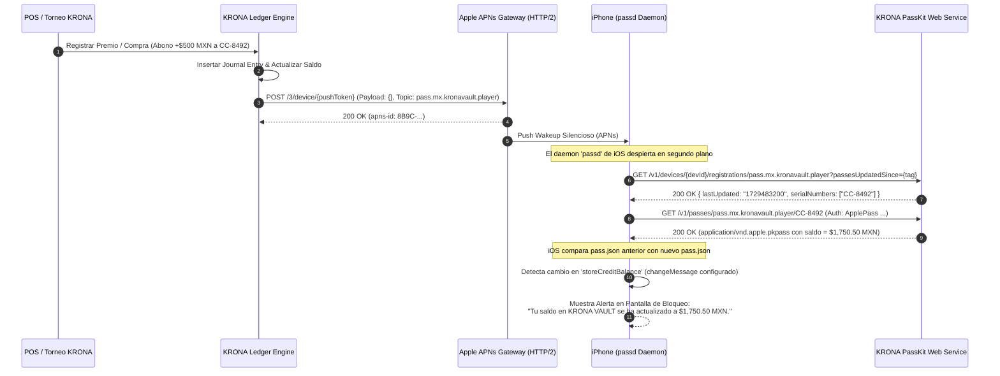

# Documento de Arquitectura y Especificación Técnica: Apple Wallet (PassKit / iOS) en KRONA VAULT

**Versión:** 1.0.0  
**Fecha:** Octubre 2026  
**Sistema:** KRONA VAULT (Monorepo `controlCredito`)  
**Módulos Impactados:** `apps/api` (PassKit Web Service & Signer), `packages/shared-types`, `apps/web-pwa` (Botón "Add to Apple Wallet")

---

## 1. Estructura y Anatomía del Archivo `.pkpass`

El archivo `.pkpass` es un contenedor comprimido estándar ZIP (con compresión Deflate) que no debe contener carpetas raíz intermedias (los archivos residen en la raíz del archivo ZIP). Su tipo MIME oficial es:
```http
Content-Type: application/vnd.apple.pkpass
```

### 1.1. Selección del Tipo de Pass: `storeCard` vs `generic`

PassKit define cinco familias de pases (`boardingPass`, `coupon`, `eventTicket`, `storeCard`, `generic`). Para la tarjeta de jugador y saldo de tienda en KRONA VAULT, **la elección mandataria es `storeCard`**.

| Criterio Técnico / Visual | `storeCard` (Recomendado) | `generic` |
| :--- | :--- | :--- |
| **Propósito Semántico de Apple** | Tarjetas de lealtad de clientes, monederos de crédito en tienda (*Store Credit*), gift cards y membresías TCG. | Tarjetas de identificación genéricas, resguardos de guardarropa, pases de casillero. |
| **Soporte de Banner Gráfico (`strip.png`)** | **Sí (Nativo a pantalla completa)**. Ocupa 375×123 pt (750×248 px @2x, 1125×372 px @3x), permitiendo lucir arte temático de KRONA VAULT y texturas holográficas TCG. | **No soporta `strip.png`**. Utiliza `thumbnail.png` (90×90 pt) en una esquina, perdiendo impacto estético. |
| **Distribución de Campos Primarios** | El campo primario (Saldo MXN o Nombre) se renderiza con tipografía prominente sobre o bajo la franja de arte. | Los campos primarios se alinean junto al thumbnail pequeño. |
| **Agrupación en iOS Wallet** | Apple Wallet agrupa y apila automáticamente los pases bajo la categoría de tarjetas de valor acumulado y fidelidad. | Se apila como pase genérico sin jerarquía comercial. |
| **Notificaciones de Cambio (`changeMessage`)** | Pleno soporte en la pantalla de bloqueo cuando el saldo o nivel cambia tras una compra o torneo. | Soportado, pero visualmente secundario. |

---

### 1.2. Contenido del Bundle ZIP

Un archivo `player-CC8492.pkpass` contiene los siguientes archivos binarios y descriptores:

```text
player-CC8492.pkpass (ZIP archive)
├── pass.json                  # Definición estructural, datos del jugador, colores y endpoints
├── manifest.json              # Hashes criptográficos SHA-256 de todos los recursos
├── signature                  # Firma digital PKCS#7 desprendida (DER binario)
├── icon.png                   # Ícono de notificación (29×29 pt -> 29×29 px @1x)
├── icon@2x.png                # Ícono Retina (58×58 px)
├── icon@3x.png                # Ícono Super Retina (87×87 px)
├── logo.png                   # Logotipo KRONA VAULT (hasta 160×50 pt -> 160×50 px @1x)
├── logo@2x.png                # Logotipo Retina (320×100 px)
├── logo@3x.png                # Logotipo Super Retina (480×150 px)
├── strip.png                  # Banner horizontal de arte (375×123 pt -> 375×123 px @1x)
├── strip@2x.png               # Banner Retina (750×248 px)
├── strip@3x.png               # Banner Super Retina (1125×372 px)
└── es.lproj/                  # (Opcional) Localización de etiquetas
    └── pass.strings
```

---

### 1.3. Especificación Completa de `pass.json`

A continuación se detalla la configuración JSON de producción para la tarjeta del jugador en KRONA VAULT:

```json
{
  "formatVersion": 1,
  "passTypeIdentifier": "pass.mx.kronavault.player",
  "serialNumber": "CC-8492",
  "teamIdentifier": "9K3X2B8LA1",
  "organizationName": "KRONA VAULT Games & TCG",
  "description": "Tarjeta de Jugador y Crédito de Tienda KRONA VAULT",
  "logoText": "KRONA VAULT",
  "foregroundColor": "rgb(255, 255, 255)",
  "backgroundColor": "rgb(15, 23, 42)",
  "labelColor": "rgb(148, 163, 184)",
  
  "webServiceURL": "https://api.kronavault.mx/v1/passkit",
  "authenticationToken": "sec_auth_9f81a7b8e234c8916d3f281984a92c3d",

  "sharingProhibited": false,
  "voided": false,

  "storeCard": {
    "headerFields": [
      {
        "key": "storeCreditBalance",
        "label": "SALDO DISPONIBLE",
        "value": 1250.50,
        "currencyCode": "MXN",
        "changeMessage": "Tu saldo en KRONA VAULT se ha actualizado a %@."
      }
    ],
    "primaryFields": [
      {
        "key": "playerName",
        "label": "JUGADOR",
        "value": "Alejandro Silva",
        "changeMessage": "Perfil de jugador actualizado a %@"
      }
    ],
    "secondaryFields": [
      {
        "key": "memberCode",
        "label": "NO. MIEMBRO",
        "value": "CC-8492"
      },
      {
        "key": "playerRank",
        "label": "RANGO COMPETITIVO",
        "value": "MYTHIC TIER",
        "changeMessage": "¡Felicidades! Has ascendido a %@"
      }
    ],
    "auxiliaryFields": [
      {
        "key": "homeBranch",
        "label": "SUCURSAL BASE",
        "value": "KRONA Centro"
      },
      {
        "key": "lastUpdated",
        "label": "ÚLTIMO CORTE",
        "value": "2026-10-21T03:00:00Z",
        "dateStyle": "PKDateStyleShort",
        "timeStyle": "PKDateStyleShort"
      }
    ],
    "backFields": [
      {
        "key": "backTermsTitle",
        "label": "TÉRMINOS DEL CRÉDITO DE TIENDA",
        "value": "El saldo reflejado en esta tarjeta constituye Crédito de Tienda oficial de KRONA VAULT amparado por el sistema de contabilidad de doble partida de la organización. Puede utilizarse para la compra de producto sellado, cartas individuales (singles), accesorios oficiales y pago de inscripciones a torneos oficiales."
      },
      {
        "key": "backAntiCashOut",
        "label": "POLÍTICA ESTRICTA ANTI-CASH-OUT",
        "value": "Bajo ninguna circunstancia el saldo de crédito en tienda podrá ser canjeado por dinero en efectivo, transferido a cuentas bancarias externas o retirado en caja, en cumplimiento con las regulaciones comerciales y normativas de prevención fiscal para torneos y premios."
      },
      {
        "key": "backBranches",
        "label": "SUCURSALES PARTICIPANTES",
        "value": "• KRONA Centro (Matriz): Av. Insurgentes Sur 452\n• KRONA Sur (Torneos): Plaza Galerías Local 18\n• KRONA Zapopan: Av. Vallarta 1200"
      },
      {
        "key": "backPwaLink",
        "label": "PORTAL DEL JUGADOR (PWA)",
        "value": "https://vault.kronavault.mx/wallet",
        "dataDetectorTypes": ["PKDataDetectorTypeLink"]
      },
      {
        "key": "backSupportPhone",
        "label": "ATENCIÓN A CLIENTES Y DISPUTAS",
        "value": "+52 55 8492 0000",
        "dataDetectorTypes": ["PKDataDetectorTypePhoneNumber"]
      },
      {
        "key": "backDeviceSecurity",
        "label": "HASH DE IDENTIDAD CRIPTOGRÁFICA",
        "value": "HMAC-SHA256 • PassKit Sync Engine v2"
      }
    ]
  },

  "barcodes": [
    {
      "format": "PKBarcodeFormatQR",
      "message": "CC1:WALLET:CC-8492:sec_auth_9f81a7b8e234c8916d3f281984a92c3d",
      "messageEncoding": "iso-8859-1",
      "altText": "CC-8492 • Mostrar en Mostrador"
    }
  ],

  "locations": [
    {
      "latitude": 19.418420,
      "longitude": -99.167380,
      "relevantText": "¡Bienvenido a KRONA Centro! Tu saldo disponible es $1,250.50 MXN."
    },
    {
      "latitude": 19.351230,
      "longitude": -99.176420,
      "relevantText": "Estás en KRONA Sur (Torneos). Saldo disponible: $1,250.50 MXN."
    }
  ],

  "ibeacons": [
    {
      "proximityUUID": "E2C56DB5-DFFB-48D2-B060-D0F5A71096E0",
      "major": 1,
      "minor": 101,
      "relevantText": "Mostrador KRONA Centro: Listo para escanear tu pase."
    }
  ]
}
```

---

## 2. Requisitos de Certificados y Criptografía de Apple

La emisión y validez de un archivo `.pkpass` exige una firma criptográfica PKCS#7 en formato DER desprendido (*detached*), validada por la cadena de confianza de Apple.

```
┌────────────────────────────────────────────────────────┐
│  Apple Inc. Root Certificate Authority                 │
└──────────────────────────┬─────────────────────────────┘
                           │ Valida
┌──────────────────────────▼─────────────────────────────┐
│  Apple Worldwide Developer Relations CA - G4 (WWDR G4) │
└──────────────────────────┬─────────────────────────────┘
                           │ Emite
┌──────────────────────────▼─────────────────────────────┐
│  Pass Type ID Certificate: pass.mx.kronavault.player   │
└────────────────────────────────────────────────────────┘
```

### 2.1. Apple Developer Program y Pass Type Identifier
1. **Pass Type ID:** Se registra en el portal de desarrolladores de Apple (*Certificates, Identifiers & Profiles > Pass Type IDs*) como `pass.mx.kronavault.player`.
2. **Team ID:** Identificador único de 10 caracteres alfanuméricos proporcionado por Apple (ej. `9K3X2B8LA1`).
3. El `passTypeIdentifier` y el `teamIdentifier` del `pass.json` **deben coincidir con total exactitud** con el certificado de firma; de lo contrario, iOS rechazará el pase con el error genérico `"The pass cannot be read because it isn't valid"`.

### 2.2. Flujo de Generación de Claves y Certificados

1. **Generación de Llave Privada RSA (2048-bit) y CSR:**
   ```bash
   # Generar clave privada del pase
   openssl genrsa -out pass_key.pem 2048

   # Crear Certificate Signing Request (CSR)
   openssl req -new -key pass_key.pem -out pass.csr \
     -subj "/CN=Pass Type Certificate: pass.mx.kronavault.player/OU=9K3X2B8LA1/O=KRONA VAULT/C=MX"
   ```
2. **Obtención del Certificado en Apple:**
   - Cargar `pass.csr` en el portal de Apple Developer y descargar `pass.cer`.
   - Convertir de formato DER a PEM:
     ```bash
     openssl x509 -inform DER -in pass.cer -out pass_cert.pem
     ```
3. **Descarga del Certificado Intermedio Apple WWDR G4:**
   - Descargar el certificado `AppleWWDRCAG4.cer` directamente de Apple PKI:
     ```bash
     curl -s https://www.apple.com/certificateauthority/AppleWWDRCAG4.cer -o AppleWWDRCAG4.cer
     openssl x509 -inform DER -in AppleWWDRCAG4.cer -out wwdr_g4.pem
     ```

---

### 2.3. Algoritmo de Creación de `manifest.json` y Firma Digital

1. **Generación de `manifest.json`:**
   Se calcula el digest **SHA-256** de cada archivo del paquete (excepto `manifest.json` y `signature`).
   ```json
   {
     "pass.json": "a35d72f...91",
     "icon.png": "e14b29c...34",
     "icon@2x.png": "c88214a...01",
     "logo.png": "b83371f...aa",
     "logo@2x.png": "52f9901...cd",
     "strip.png": "109823e...bf",
     "strip@2x.png": "887a412...ee"
   }
   ```
2. **Firma Criptográfica PKCS#7 / CMS:**
   - **Comando OpenSSL equivalente:**
     ```bash
     openssl smime -sign -binary \
       -in manifest.json \
       -out signature \
       -outform DER \
       -signer pass_cert.pem \
       -inkey pass_key.pem \
       -certfile wwdr_g4.pem
     ```
   - **Implementación Programática en Node.js / TypeScript (`apps/api`):**
     Para un rendimiento de alta velocidad en producción sin depender de subprocesos CLI de shell, se utiliza la librería criptográfica nativa de Node.js `node:crypto` o `@walletpass/pass-js` / `node-forge`:

```typescript
// apps/api/src/services/apple-pass-signer.service.ts
import { createHash } from 'node:crypto';
import forge from 'node-forge';
import AdmZip from 'adm-zip';

export interface PassAsset {
  filename: string;
  buffer: Buffer;
}

export class ApplePassSignerService {
  constructor(
    private readonly certPem: string,
    private readonly keyPem: string,
    private readonly wwdrPem: string
  ) {}

  public generateSignedPassBundle(passJsonContent: object, rawAssets: PassAsset[]): Buffer {
    const zip = new AdmZip();
    const manifest: Record<string, string> = {};

    // 1. Agregar pass.json
    const passJsonBuffer = Buffer.from(JSON.stringify(passJsonContent, null, 2), 'utf-8');
    zip.addFile('pass.json', passJsonBuffer);
    manifest['pass.json'] = createHash('sha256').update(passJsonBuffer).digest('hex');

    // 2. Agregar activos gráficos e indexar en manifest
    for (const asset of rawAssets) {
      zip.addFile(asset.filename, asset.buffer);
      manifest[asset.filename] = createHash('sha256').update(asset.buffer).digest('hex');
    }

    // 3. Serializar manifest.json
    const manifestBuffer = Buffer.from(JSON.stringify(manifest), 'utf-8');
    zip.addFile('manifest.json', manifestBuffer);

    // 4. Firmar manifest.json en formato PKCS#7 DER
    const signatureBuffer = this.signManifest(manifestBuffer);
    zip.addFile('signature', signatureBuffer);

    return zip.toBuffer();
  }

  private signManifest(manifestBuffer: Buffer): Buffer {
    const cert = forge.pki.certificateFromPem(this.certPem);
    const privateKey = forge.pki.privateKeyFromPem(this.keyPem);
    const wwdrCert = forge.pki.certificateFromPem(this.wwdrPem);

    const p7 = forge.pkcs7.createSignedData();
    p7.content = forge.util.createBuffer(manifestBuffer.toString('binary'));
    p7.addCertificate(cert);
    p7.addCertificate(wwdrCert);
    p7.addSigner({
      key: privateKey,
      certificate: cert,
      digestAlgorithm: forge.pki.oids.sha256,
      authenticatedAttributes: [
        {
          type: forge.pki.oids.contentType,
          value: forge.pki.oids.data,
        },
        {
          type: forge.pki.oids.messageDigest,
        },
        {
          type: forge.pki.oids.signingTime,
          value: new Date(),
        },
      ],
    });

    p7.sign({ detached: true });
    const derBinary = forge.asn1.toDer(p7.toAsn1()).getBytes();
    return Buffer.from(derBinary, 'binary');
  }
}
```

---

## 3. Servicio Web de Actualizaciones en Tiempo Real (Apple PassKit Web Service)

Apple Wallet incorpora un cliente HTTP nativo que implementa un protocolo REST estándar definido por Apple.

### 3.1. Autenticación HTTP
Todas las peticiones del dispositivo iOS envían el encabezado de autorización:
```http
Authorization: ApplePass <authenticationToken>
```
Donde `<authenticationToken>` es el valor estipulado en el `pass.json`. El backend debe validar que el token coincida con el pase registrado para el `serialNumber`.

---

### 3.2. Catálogo Oficial de Endpoints

#### 1. Registro del Dispositivo
```http
POST /v1/devices/{deviceLibraryIdentifier}/registrations/{passTypeIdentifier}/{serialNumber}
Host: api.kronavault.mx
Authorization: ApplePass sec_auth_9f81a7b8e234c8916d3f281984a92c3d
Content-Type: application/json

{
  "pushToken": "740f4707bebcf74f9b7c25d48e3358945f6aa01da5ddb387462c7eaf61bb78ad"
}
```
- **Códigos de Respuesta:**
  - `201 Created`: Dispositivo registrado por primera vez para este pase.
  - `200 OK`: El dispositivo ya estaba registrado previamente.
  - `401 Unauthorized`: Token de autenticación inválido.

#### 2. Consulta de Pases Actualizados
```http
GET /v1/devices/{deviceLibraryIdentifier}/registrations/{passTypeIdentifier}?passesUpdatedSince={previousTag}
Host: api.kronavault.mx
```
- **Códigos de Respuesta:**
  - `200 OK`: Existen cambios. Retorna JSON:
    ```json
    {
      "lastUpdated": "1729482000000",
      "serialNumbers": ["CC-8492"]
    }
    ```
  - `204 No Content`: Ningún pase ha cambiado desde `passesUpdatedSince`.

#### 3. Descarga de la Última Versión del `.pkpass`
```http
GET /v1/passes/{passTypeIdentifier}/{serialNumber}
Host: api.kronavault.mx
Authorization: ApplePass sec_auth_9f81a7b8e234c8916d3f281984a92c3d
If-Modified-Since: Tue, 21 Oct 2026 03:00:00 GMT
```
- **Códigos de Respuesta:**
  - `200 OK`: Retorna el `.pkpass` recién firmado con `Content-Type: application/vnd.apple.pkpass` y encabezado `Last-Modified`.
  - `304 Not Modified`: El pase no ha sufrido modificaciones.

#### 4. Desregistro de Dispositivo (Al borrar el pase en Wallet)
```http
DELETE /v1/devices/{deviceLibraryIdentifier}/registrations/{passTypeIdentifier}/{serialNumber}
Host: api.kronavault.mx
Authorization: ApplePass sec_auth_9f81a7b8e234c8916d3f281984a92c3d
```
- **Respuesta:** `200 OK`. Elimina el registro del dispositivo en la base de datos de la bóveda.

#### 5. Telemetría y Errores Reportados por iOS
```http
POST /v1/log
Host: api.kronavault.mx
Content-Type: application/json

{
  "logs": [
    "[2026-10-21 03:05:12 -0600] passd: Updating pass.mx.kronavault.player (CC-8492)"
  ]
}
```
- **Respuesta:** `200 OK`. Almacena telemetría en Winston / Pino para diagnósticos.

---

### 3.3. Protocolo de Wakeup por APNs (Apple Push Notification service)

Cuando ocurre un evento contable en `controlCredito` (ej. abono por premio de torneo o compra de singles), el backend **no envía el saldo nuevo en el payload de APNs**. En PassKit, el push es un **wake-up silencioso** cuyo payload es un diccionario JSON estrictamente vacío (`{}`):

```json
{}
```



#### Parámetros Técnicos de Conexión APNs:
- **Endpoint HTTP/2:** `api.push.apple.com:443` (Producción) o `api.sandbox.push.apple.com:443` (Desarrollo).
- **Cabeceras HTTP/2 Requeridas:**
  - `:method: POST`
  - `:path: /3/device/<pushToken>`
  - `apns-topic: pass.mx.kronavault.player` (Debe coincidir exactamente con el Pass Type ID).
  - `apns-push-type: background` o `alert` (para pases Wallet, Apple procesa el topic `pass.<id>` y no requiere `apns-priority: 10`, `apns-priority: 5` es el valor por defecto para balance de batería).
- **Autenticación mTLS:** Conexión TLS mutua utilizando el mismo `pass_cert.pem` y `pass_key.pem`.

---

## 4. Geolocalización, iBeacons y Relevancia en Pantalla de Bloqueo

Apple Wallet cuenta con un motor de relevancia context-aware en iOS que hace que la tarjeta aparezca automáticamente en la pantalla de bloqueo cuando el jugador se encuentra físicamente cerca de la tienda o en el mostrador.

### 4.1. Parámetros de Geolocalización (`locations`)
- Se pueden registrar hasta 10 ubicaciones geográficas por pase.
- **Campos:**
  - `latitude` (Float): Latitud decimal con precisión mínima de 6 decimales.
  - `longitude` (Float): Longitud decimal.
  - `relevantText`: Mensaje dinámico de bienvenida que aparece en la pantalla de bloqueo cuando el dispositivo entra en la geocerca (radio aproximado de 100 a 150 metros determinado por CoreLocation).
  - `maxDistance`: Parámetro no oficial (Apple calcula dinámicamente el radio de proximidad basándose en el tipo de pase `storeCard`).

### 4.2. Balizas Bluetooth de Baja Energía (`ibeacons`)
Para una experiencia VIP sin fricción al llegar a la caja:
- Se instala una baliza BLE (ej. Estimote, Kontakt.io o Raspberry Pi BLE) en cada mostrador de KRONA.
- **Configuración en `pass.json`:**
  - `proximityUUID`: Identificador único corporativo de KRONA VAULT (ej. `E2C56DB5-DFFB-48D2-B060-D0F5A71096E0`).
  - `major`: Código de Sucursal (`1` = KRONA Centro, `2` = KRONA Sur).
  - `minor`: Número de Mostrador o Estación (`101` = Caja 1, `102` = Caja 2, `201` = Bóveda / Vault Inspection).
  - `relevantText`: *"Mostrador KRONA Centro: Listo para escanear tu pase y aplicar crédito."*
- **Comportamiento en iOS:**
  En cuanto el jugador llega a menos de 2 metros del mostrador, iOS detecta el iBeacon y presenta la tarjeta en la pantalla con un solo toque (o doble clic en el botón lateral del iPhone), lista para que el cajero escanee el código QR sin que el jugador tenga que desbloquear el teléfono o buscar en aplicaciones.

---

## 5. Esquema de Base de Datos para Persistencia de Registros PassKit

En PostgreSQL (`infra/postgres`):

```sql
CREATE TABLE wallet_pass_registrations (
    id UUID PRIMARY KEY DEFAULT gen_random_uuid(),
    device_library_identifier VARCHAR(128) NOT NULL,
    push_token VARCHAR(256) NOT NULL,
    pass_type_identifier VARCHAR(128) NOT NULL,
    serial_number VARCHAR(64) NOT NULL,
    authentication_token VARCHAR(128) NOT NULL,
    user_id VARCHAR(64) NOT NULL REFERENCES users(id),
    created_at TIMESTAMPTZ DEFAULT NOW(),
    updated_at TIMESTAMPTZ DEFAULT NOW(),
    UNIQUE(device_library_identifier, pass_type_identifier, serial_number)
);

CREATE INDEX idx_pass_registrations_lookup 
ON wallet_pass_registrations (device_library_identifier, pass_type_identifier);

CREATE INDEX idx_pass_registrations_push 
ON wallet_pass_registrations (pass_type_identifier, serial_number);
```

---

## 6. Consideraciones de Seguridad y Despliegue en KRONA VAULT

1. **Gestión de Secretos Criptográficos:**
   - `PASS_CERT_PEM`, `PASS_KEY_PEM` y `WWDR_G4_PEM` deben inyectarse mediante variables de entorno seguras codificadas en Base64 o administradas mediante AWS Secrets Manager / HashiCorp Vault.
2. **Prevención de Suplantación de Pases:**
   - El código QR del pase contiene el `serialNumber` acompañado de una firma de autorización o token interno que el POS valida contra el motor de contabilidad en tiempo real.
3. **Resiliencia ante Caídas de Red (Modo Offline / Sótano):**
   - Si la tienda local pierde conexión a internet momentáneamente, el código de miembro visible (`altText: "CC-8492"`) o el código numérico de respaldo puede validarse utilizando el algoritmo TOTP determinista offline ya implementado en `@control-credito/crypto-totp`.

Este diseño proporciona una integración de grado bancario y experiencia de usuario nativa de Apple para el ecosistema de jugadores de KRONA VAULT.