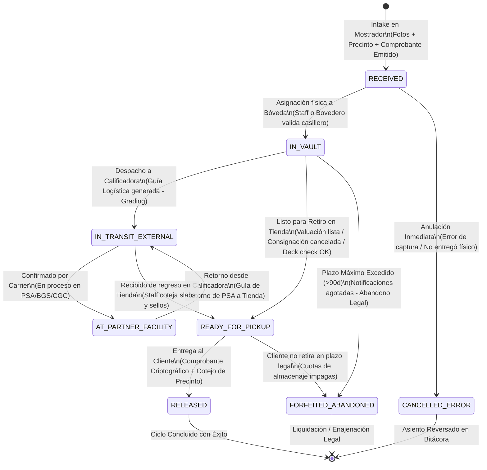
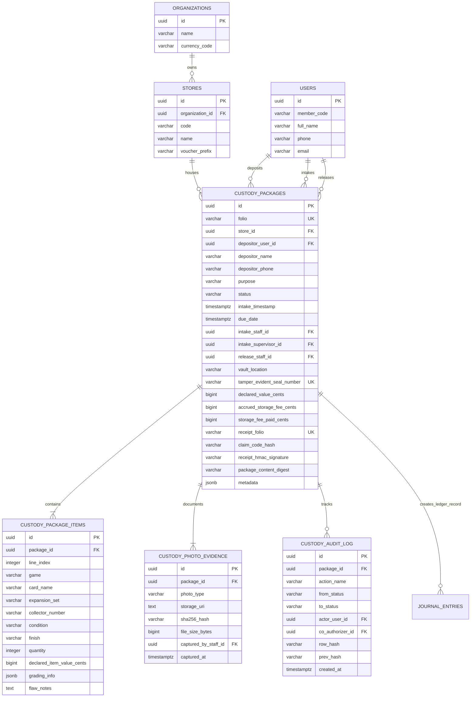
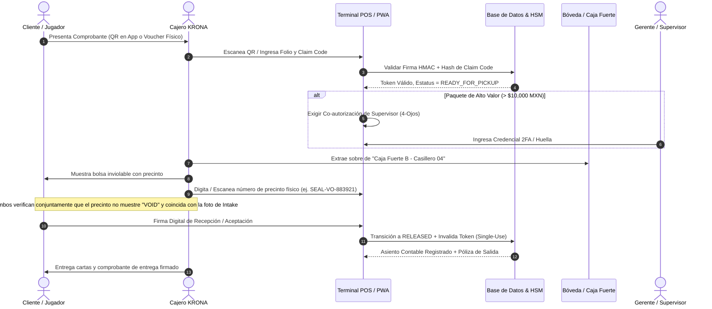

# KRONA VAULT — Modelo de Dominio, Ciclo de Vida y Arquitectura de Datos para Cartas y Paquetes en Resguardo (Vault Custody & Escrow)

**Versión:** 1.0.0  
**Fecha:** 2026-10-20  
**Estado:** Propuesta Técnica de Arquitectura Aprobada para Implementación  
**Alcance:** Monorepo `controlCredito` (`packages/shared-types`, `packages/crypto-totp`, `apps/api`, `apps/web-pwa`, `infra/postgres`)

---

## 1. Resumen Ejecutivo y Contexto de Negocio TCG

En el ecosistema de las tiendas de juegos locales (LGS - *Local Game Stores*) y las comunidades de cartas coleccionables de alto nivel competitivo (*Magic: The Gathering, Pokémon TCG, Yu-Gi-Oh!, One Piece Card Game, Lorcana, Star Wars: Unlimited*), la custodia física de activos de alto valor representa simultáneamente una **fuente crítica de ingresos y fidelización** y un **vector severo de riesgo operativo y reputacional**.

Las cartas coleccionables individuales y los sobres sellados históricos alcanzan valores que van desde cientos hasta decenas de miles de dólares estadounidenses (ej. *Black Lotus*, *Charizard 1st Edition Shadowless*, cartas serializadas o decks competitivos completos de formato *Modern/Pioneer/Standard* valuados entre $1,000 y $8,000 USD).

### 1.1. Problemáticas Críticas del Modelo Tradicional de Mostrador

1. **Riesgo de "Bait & Switch" (Cambiata de Cartas y Disputas de Condición):**  
   Clientes que dejan cartas para valuación o consignación y posteriormente alegan que la tienda les devolvió una copia diferente en peor condición (*"Mi carta era Near Mint y me están entregando una Moderately Played rayada"*). De igual modo, operarios desleales podrían sustituir cartas caras por copias de menor calidad.
2. **Falta de Certeza en la Entrega (Suplantación de Identidad y Pérdida de Boletos):**  
   Boletos de papel térmico simples o notas manuscritas que pueden fotocopiarse, extraviarse o ser presentadas por terceros no autorizados que conocen el nombre del cliente.
3. **Paquetes en Cuarentena durante Torneos Oficiales:**  
   En torneos competitivos de alta envergadura (*Regional Championships, RCQs, Grand Openings*), los jueces oficiales deben retener barajas para revisión (*Deck Check*) o para el *Top 8 Lockdown* (evitar adulteración o inserción de cartas prohibidas entre rondas).
4. **Fricción en Consignaciones P2P (Escrow entre Jugadores):**  
   Jugadores que quieren concretar transacciones de cartas caras pero temen asaltos o fraudes en la calle. La tienda funge como garante físico (*Escrow Agent*), pero sin un sistema formal los encargados de mostrador se confunden sobre pagos, comisiones e inventario.
5. **Consolidación Logística de Calificación (Grading Hub):**  
   El envío individual a empresas como PSA, BGS (Beckett) o CGC resulta prohibitivo en flete internacional y aduanas para un solo jugador. La tienda consolida paquetes de 20 o 50 jugadores, pero requiere rastreo quirúrgico de cada ejemplar, número de certificado, desglose de seguro y estatus en tránsito.
6. **Abandono de Lotes Bulk y Ocupación Indebida:**  
   Clientes que dejan cajas con miles de cartas para revisión de bulk y nunca regresan a recoger lo que no se les compró, convirtiendo la trastienda en una bodega gratuita.

**KRONA VAULT** resuelve estas problemáticas mediante un modelo de dominio formal, una máquina de estados finita auditable, comprobantes criptográficos infalsificables (HMAC-SHA256), sellado inviolable con soporte fotográfico inmutable y una integración nativa con el motor de contabilidad por partida doble de `controlCredito`.

---

## 2. Entidad `CustodyPackageRecord` y Modelo de Dominio

El modelo de dominio desacopla la recepción del paquete (*envelope/box/container*), su contenido individualizado (*items*), la evidencia fotográfica inmutable (*photo evidence*) y el historial de transiciones firmado.

### 2.1. Propósitos y Modalidades de Resguardo (`CustodyPurpose`)

| Código | Modalidad | Descripción Operativa y Regla de Negocio |
| :--- | :--- | :--- |
| `GRADING_SUBMISSION` | Envío a Calificación | Cartas consolidadas en tienda para ser enviadas en lote a calificadoras oficiales (PSA, BGS, CGC, ARS). Incluye tracking de guía, orden de servicio y retorno. |
| `CONSIGNMENT_ESCROW` | Consignación / Venta P2P | Carta exhibida en vitrina para venta a terceros o compra acordada entre jugadores con liquidación automática a través del saldo de KRONA. |
| `DETAILED_APPRAISAL_PENDING` | Valuación Minuciosa / Bulk | Cartas dejadas para autenticación detallada con lupa/microscopio/luz UV o conteo de lotes masivos de bulk (>1,000 cartas). |
| `TOURNAMENT_DECK_QUARANTINE` | Cuarentena de Baraja | Deck de jugador competitivo resguardado por el Juez Principal / Staff durante cortes de torneo (*Top 8*, revisiones de legalidad). |
| `SAFE_KEEPING_VAULT` | Custodia en Bóveda | Guarda y custodia de seguridad temporal en caja fuerte blindada para jugadores foráneos o coleccionistas privados. |

---

### 2.2. Definiciones TypeScript Exhaustivas (`packages/shared-types`)

```typescript
// =============================================================================
// KRONA VAULT: Custody & Escrow Domain Types
// =============================================================================

export type CustodyPurpose =
  | 'GRADING_SUBMISSION'
  | 'CONSIGNMENT_ESCROW'
  | 'DETAILED_APPRAISAL_PENDING'
  | 'TOURNAMENT_DECK_QUARANTINE'
  | 'SAFE_KEEPING_VAULT';

export type CustodyStatus =
  | 'RECEIVED'
  | 'IN_VAULT'
  | 'IN_TRANSIT_EXTERNAL'
  | 'AT_PARTNER_FACILITY'
  | 'READY_FOR_PICKUP'
  | 'RELEASED'
  | 'CANCELLED_ERROR'
  | 'FORFEITED_ABANDONED';

export type CardConditionGrade =
  | 'NM'   // Near Mint
  | 'LP'   // Lightly Played
  | 'MP'   // Moderately Played
  | 'HP'   // Heavily Played
  | 'DMG'  // Damaged
  | 'SEALED'; // Producto sellado de fábrica

export type CardFinishType =
  | 'REGULAR'
  | 'FOIL'
  | 'HOLO'
  | 'REVERSE_HOLO'
  | 'TEXTURED'
  | 'SERIALIZED'
  | 'ETCHED'
  | 'OVERSIZED';

export type TcgGameType =
  | 'POKEMON'
  | 'MAGIC_THE_GATHERING'
  | 'YUGIOH'
  | 'ONE_PIECE'
  | 'LORCANA'
  | 'STAR_WARS_UNLIMITED'
  | 'DIGIMON'
  | 'OTHER';

export type CustodyPhotoType =
  | 'FRONT'          // Vista frontal del sobre / empaque exterior
  | 'BACK'           // Vista posterior
  | 'SEAL'           // Macro del precinto de seguridad con número de serie visible
  | 'CONTENT'        // Desglose de cartas sobre tapete milimetrado
  | 'DETAIL_FLAW'    // Detalle de imperfección preexistente (doblez, rayón, blanqueo)
  | 'RELEASE_PROOF'; // Evidencia fotográfica al momento de la entrega física

export type ClaimVerificationMethod =
  | 'APP_DYNAMIC_QR'         // QR Dinámico TOTP de la PWA KRONA
  | 'THERMAL_RECEIPT_HMAC'   // Voucher térmico físico con sello HMAC verificado en POS
  | 'GOVERNMENT_ID_MATCH'    // Cotejo de identificación oficial (INE / Pasaporte)
  | 'PROXY_DELEGATED_TOKEN'  // Token de recolección para terceros autorizado por titular
  | 'SUPERVISOR_OVERRIDE';   // Co-autorización de 4 Ojos por pérdida justificada de comprobante

export interface PreExistingGradingInfo {
  gradingCompany: 'PSA' | 'BGS' | 'CGC' | 'ARS' | 'SGC' | 'ACE' | 'OTHER';
  grade: string;             // ej. "9.5", "10 GEM MT", "Black Label"
  certNumber: string;        // ej. "78912401"
  isAuthenticOnly?: boolean;
}

/**
 * Detalle individual de cada carta o producto sellado dentro del paquete
 */
export interface CustodyItemRecord {
  id: string;
  packageId: string;
  lineIndex: number;
  game: TcgGameType;
  cardName: string;
  expansionSet: string;
  collectorNumber: string;
  language: string;          // ej. "EN", "JP", "ES"
  finish: CardFinishType;
  quantity: number;
  condition: CardConditionGrade;
  declaredItemValueCents: number;
  preExistingGrading?: PreExistingGradingInfo | null;
  flawNotes?: string | null;  // ej. "Punto blanco en esquina sup-izq; hendidura leve en reverso"
  targetSellPriceCents?: number | null; // Para CONSIGNMENT_ESCROW
  gradingTargetService?: string | null; // ej. "PSA Regular $75 tier", "Subgrades required"
  createdAt: string;
}

/**
 * Soporte de fotos con hash inmutable de integridad
 */
export interface CustodyPhotoEvidence {
  id: string;
  packageId: string;
  photoType: CustodyPhotoType;
  storageUri: string;         // URL en Cloudflare R2 / S3 / Local Storage
  sha256Hash: string;         // Hash SHA-256 binario del archivo para garantizar no-adulteración
  fileSizeBytes: number;
  mimeType: string;           // ej. "image/webp", "image/jpeg"
  notes?: string | null;
  capturedByStaffId: string;
  capturedAt: string;
}

/**
 * Metadatos especializados según el propósito del resguardo
 */
export interface GradingSubmissionMetadata {
  gradingCompany: 'PSA' | 'BGS' | 'CGC' | 'ARS';
  bulkBatchCode: string;          // ej. "PSA-2026-Q4-BATCH-02"
  declaredTier: string;           // ej. "Value Bulk", "Regular", "Express"
  outboundTrackingNumber?: string;
  inboundTrackingNumber?: string;
  partnerOrderReference?: string; // ID de orden oficial en portal de la calificadora
  estimatedTurnaroundDays: number;
  actualReturnDate?: string;
}

export interface ConsignmentMetadata {
  targetSellPriceCents: number;
  minimumAcceptablePriceCents: number;
  storeCommissionBps: number;     // Puntos base (ej. 1000 = 10.00%)
  allowSplitSale: boolean;        // Si se venden cartas individuales o paquete completo
  payoutMethod: 'STORE_CREDIT' | 'CASH_BANK_TRANSFER';
  storeCreditBonusBps?: number;   // Incentivo (ej. +5% si cobra en crédito de tienda)
  buyerUserId?: string;           // Usuario que adquirió la carta en consignación
  buyerPurchasedAt?: string;
}

export interface TournamentQuarantineMetadata {
  tournamentId: string;
  tournamentName: string;
  roundNumber?: number;
  headJudgeUserId: string;
  headJudgeName: string;
  decklistRegistrationHash: string; // Hash SHA-256 del decklist registrado
  tableNumber?: number;
  mandatoryReturnBeforeRound?: number;
}

export interface AppraisalMetadata {
  appraiserStaffId: string;
  appraisalFeeCents: number;
  appraisalScope: 'AUTHENTICITY_VERIFICATION' | 'BULK_COUNT_BUYLIST' | 'VINTAGE_CONDITION_AUDIT';
  offerMadeCents?: number;
  offerAccepted?: boolean;
}

/**
 * Entidad Principal: CustodyPackageRecord
 */
export interface CustodyPackageRecord {
  id: string;                     // UUID v4 interno
  folio: string;                  // ID legible único ej. "CUST-CEN-20261020-00142"
  organizationId: string;
  storeId: string;
  storeCode: string;

  // Depositante / Cliente
  depositorUserId?: string | null;      // Opcional si es usuario registrado en KRONA
  depositorMemberCode?: string | null;  // ej. "CC-8492"
  depositorName: string;                // Nombre completo
  depositorPhone: string;               // Teléfono móvil (para SMS / WhatsApp alertas)
  depositorEmail?: string | null;
  depositorGovIdType?: string | null;   // "INE", "PASSPORT", "DRIVER_LICENSE"
  depositorGovIdNumber?: string | null; // Requerido para paquetes de alto valor

  // Propósito y Estado
  purpose: CustodyPurpose;
  status: CustodyStatus;
  statusReason?: string | null;

  // Fechas y Cronología
  intakeTimestamp: string;
  dueDate: string;                      // Fecha estimada o límite de retiro
  statusUpdatedAt: string;
  releasedAt?: string | null;

  // Operarios involucrados (Trazabilidad y 4-Ojos)
  intakeStaffId: string;
  intakeStaffName: string;
  intakeSupervisorId?: string | null;   // Requerido si declaredValueCents > 4-Eyes Threshold
  releaseStaffId?: string | null;
  releaseStaffName?: string | null;
  releaseSupervisorId?: string | null;

  // Ubicación física y Precinto
  vaultLocation: string;                // ej. "Caja Fuerte B - Casillero 04"
  shelfSlotZone: string;                // ej. "MAIN_SAFE", "DISPLAY_CASE_A", "JUDGE_STAGING"
  tamperEvidentSealNumber: string;      // ej. "SEAL-VO-883921"
  sealIntegrityVerifiedAtIntake: boolean;
  sealIntegrityVerifiedAtRelease?: boolean | null;

  // Valores y Contabilidad
  declaredValueCents: number;           // Valor declarado en centavos
  insuranceFeeCents: number;            // Cuota de seguro
  custodyDailyRateCents: number;        // Tarifa diaria/mensual de almacenamiento
  accruedStorageFeeCents: number;       // Cargos acumulados por almacenaje
  storageFeePaidCents: number;          // Monto liquidado de almacenaje
  depositSecurityCents: number;         // Depósito en garantía dejado por el cliente

  // Desglose de Contenido y Fotos
  itemsSummary: string;                 // Resumen conciso ej. "4x Underground Sea, 1x Timetwister"
  totalItemsCount: number;
  items: CustodyItemRecord[];
  photos: CustodyPhotoEvidence[];

  // Metadatos Específicos por Modalidad (JSONB tipado)
  gradingMetadata?: GradingSubmissionMetadata | null;
  consignmentMetadata?: ConsignmentMetadata | null;
  tournamentMetadata?: TournamentQuarantineMetadata | null;
  appraisalMetadata?: AppraisalMetadata | null;

  // Criptografía y Comprobante de Recepción
  receiptFolio: string;                 // ej. "REC-CEN-20261020-00142"
  claimCode: string;                    // ej. "KRON-7F2A-99B4-4821" (clave alfanumérica de retiro)
  receiptToken: string;                 // Token HMAC firmado por HSM de bóveda
  packageContentDigest: string;         // SHA-256 canónico de (items + fotos + seal + folio)
  receiptPrintCount: number;
  claimVerificationMethod?: ClaimVerificationMethod | null;
  claimIdentityEvidence?: string | null; // Referencia de identificación verificada en entrega

  // Auditoría Hash-Chain
  auditChainHash: string;
  createdAt: string;
  updatedAt: string;
}

/**
 * Póliza / Voucher de Recepción para Impresión Térmica (58mm / 80mm) y Visualización PWA
 */
export interface CustodyReceiptVoucher {
  receiptFolio: string;
  packageFolio: string;
  storeName: string;
  storeCode: string;
  storeAddress: string;
  intakeTimestampIso: string;
  dueDateIso: string;
  customerName: string;
  customerMemberCode?: string;
  purposeLabel: string;
  vaultLocationMasked: string;          // ej. "Bóveda Principal (Slot Protegido)"
  tamperEvidentSealNumber: string;
  declaredValueFormatted: string;       // ej. "$25,000.00 MXN"
  itemsSummary: string;
  totalCardsCount: number;
  intakeStaffName: string;
  claimCodeMasked: string;              // ej. "KRON-****-****-4821" (completo solo en QR y copia cliente)
  claimCodeFull: string;
  cryptographicSeal: string;            // Sello visual HMAC: XXXX-XXXX-XXXX-XXXX
  qrPayloadRaw: string;                 // Token completo codificado para escáner
  legalDisclaimer: string;              // Cláusula legal de depósito y plazo de abandono
}
```

---

## 3. Máquina de Estados Finita (`CustodyStatus`) y Ciclo de Vida

El ciclo de vida del resguardo sigue una máquina de estados finita determinista con controles estrictos de precondición, permisos de rol basados en atributos (ABAC) y co-autorización obligatoria para transiciones críticas.

### 3.1. Diagrama de Estados Mermaid (`stateDiagram-v2`)



---

### 3.2. Matriz de Transiciones y Reglas de Negocio

| Estado Origen | Estado Destino | Evento Disparador | Roles Autorizados | Precondiciones y Validaciones Críticas |
| :--- | :--- | :--- | :--- | :--- |
| `[*]` | `RECEIVED` | `INTAKE_PACKAGE` | `CASHIER`, `STORE_ADMIN` | Mínimo 3 fotos (FRONT, BACK, SEAL); precinto no reutilizado; hash canónico calculado; comprobante firmado emitido. Si `declaredValueCents >= 100,000`, requiere co-firma supervisor. |
| `RECEIVED` | `IN_VAULT` | `SECURE_IN_VAULT` | `CASHIER`, `STORE_ADMIN`, `AUDITOR` | Slot de bóveda asignado (`vaultLocation` no vacío); bolsa sin roturas; bovedero confirma recepción física en caja fuerte. |
| `RECEIVED` | `CANCELLED_ERROR` | `CANCEL_VOID` | `STORE_ADMIN` (4-Ojos) | Solo permitido dentro de las primeras 2 horas post-intake; paquete nunca ingresó a bóveda; comprobante físico destruido o anulado en sistema; motivo auditado obligatorio. |
| `IN_VAULT` | `IN_TRANSIT_EXTERNAL` | `DISPATCH_TO_PARTNER` | `STORE_ADMIN` | Solo aplica para `GRADING_SUBMISSION`; número de guía (*tracking*) registrado; lote de envío formalizado con la calificadora. |
| `IN_TRANSIT_EXTERNAL` | `AT_PARTNER_FACILITY` | `CARRIER_DELIVERED` | `STORE_ADMIN`, `SYSTEM_SYNC` | Webhook de paquetería o actualización de staff confirmando recepción en las instalaciones de PSA/BGS/CGC. |
| `AT_PARTNER_FACILITY` | `IN_TRANSIT_EXTERNAL` | `PARTNER_RETURN_SHIPPED` | `STORE_ADMIN`, `SYSTEM_SYNC` | Calificación completada; número de guía de retorno asignado; certificados capturados en sistema. |
| `IN_VAULT` o `IN_TRANSIT_EXTERNAL` | `READY_FOR_PICKUP` | `MARK_READY_PICKUP` | `CASHIER`, `STORE_ADMIN`, `TOURNAMENT_ORGANIZER` | Notificación automática (Push/Email/SMS) enviada al depositante. En consignación: comprador pagó en caja o vendedor retiró la oferta. En torneos: torneo finalizó o deck check concluyó. |
| `READY_FOR_PICKUP` | `RELEASED` | `EXECUTE_RELEASE` | `CASHIER`, `STORE_ADMIN` | **Validación estricta de comprobante**: firma HMAC verificada; precinto físico intacto cotejado contra foto de intake; cuotas de almacenamiento/servicios liquidadas; firma o foto de entrega registrada. |
| `IN_VAULT` o `READY_FOR_PICKUP` | `FORFEITED_ABANDONED` | `APPLY_LEGAL_FORFEIT` | `SUPER_ADMIN` + Dictamen Legal | Días transcurridos > 90 días desde `dueDate`; mínimo 3 notificaciones certificadas enviadas; saldo de almacenamiento acumulado impago. Póliza pasa a procedimiento de enajenación o destrucción controlada. |

---

## 4. Diagrama Entidad-Relación y Esquema PostgreSQL 16

El esquema implementa llaves foráneas estrictas, inmutabilidad de bitácora mediante triggers de PostgreSQL, índices optimizados para escaneo rápido de precintos y folios, y columnas JSONB para metadatos flexibles según la modalidad de resguardo.

### 4.1. Diagrama de Entidad-Relación Mermaid (`erDiagram`)



---

### 4.2. Esquema DDL en PostgreSQL 16 (`infra/postgres/init.sql` Extensión)

```sql
-- =============================================================================
-- KRONA VAULT: Custody & Escrow DDL
-- =============================================================================

CREATE TYPE custody_purpose_type AS ENUM (
    'GRADING_SUBMISSION',
    'CONSIGNMENT_ESCROW',
    'DETAILED_APPRAISAL_PENDING',
    'TOURNAMENT_DECK_QUARANTINE',
    'SAFE_KEEPING_VAULT'
);

CREATE TYPE custody_status_type AS ENUM (
    'RECEIVED',
    'IN_VAULT',
    'IN_TRANSIT_EXTERNAL',
    'AT_PARTNER_FACILITY',
    'READY_FOR_PICKUP',
    'RELEASED',
    'CANCELLED_ERROR',
    'FORFEITED_ABANDONED'
);

CREATE TYPE custody_photo_type AS ENUM (
    'FRONT',
    'BACK',
    'SEAL',
    'CONTENT',
    'DETAIL_FLAW',
    'RELEASE_PROOF'
);

CREATE TYPE claim_verification_type AS ENUM (
    'APP_DYNAMIC_QR',
    'THERMAL_RECEIPT_HMAC',
    'GOVERNMENT_ID_MATCH',
    'PROXY_DELEGATED_TOKEN',
    'SUPERVISOR_OVERRIDE'
);

-- Tabla Principal de Paquetes en Custodia
CREATE TABLE custody_packages (
    id UUID PRIMARY KEY DEFAULT gen_random_uuid(),
    folio VARCHAR(48) NOT NULL UNIQUE, -- ej. "CUST-CEN-20261020-00142"
    organization_id UUID NOT NULL REFERENCES organizations(id),
    store_id UUID NOT NULL REFERENCES stores(id),

    -- Cliente / Depositante
    depositor_user_id UUID REFERENCES users(id),
    depositor_member_code VARCHAR(32),
    depositor_name VARCHAR(150) NOT NULL,
    depositor_phone VARCHAR(32) NOT NULL,
    depositor_email VARCHAR(255),
    depositor_gov_id_type VARCHAR(32),
    depositor_gov_id_number VARCHAR(64),

    -- Propósito y Estado
    purpose custody_purpose_type NOT NULL,
    status custody_status_type NOT NULL DEFAULT 'RECEIVED',
    status_reason TEXT,

    -- Fechas
    intake_timestamp TIMESTAMPTZ NOT NULL DEFAULT clock_timestamp(),
    due_date TIMESTAMPTZ NOT NULL,
    status_updated_at TIMESTAMPTZ NOT NULL DEFAULT clock_timestamp(),
    released_at TIMESTAMPTZ,

    -- Staff Responsable
    intake_staff_id UUID NOT NULL REFERENCES users(id),
    intake_staff_name VARCHAR(150) NOT NULL,
    intake_supervisor_id UUID REFERENCES users(id),
    release_staff_id UUID REFERENCES users(id),
    release_staff_name VARCHAR(150),
    release_supervisor_id UUID REFERENCES users(id),

    -- Ubicación y Precinto Inviolable
    vault_location VARCHAR(120) NOT NULL, -- ej. "Caja Fuerte B - Casillero 04"
    shelf_slot_zone VARCHAR(64) NOT NULL DEFAULT 'MAIN_SAFE',
    tamper_evident_seal_number VARCHAR(64) NOT NULL UNIQUE, -- ej. "SEAL-VO-883921"
    seal_verified_at_intake BOOLEAN NOT NULL DEFAULT TRUE,
    seal_verified_at_release BOOLEAN,

    -- Valores y Contabilidad (centavos enteros)
    declared_value_cents BIGINT NOT NULL CHECK (declared_value_cents >= 0),
    insurance_fee_cents BIGINT NOT NULL DEFAULT 0 CHECK (insurance_fee_cents >= 0),
    custody_daily_rate_cents BIGINT NOT NULL DEFAULT 0 CHECK (custody_daily_rate_cents >= 0),
    accrued_storage_fee_cents BIGINT NOT NULL DEFAULT 0 CHECK (accrued_storage_fee_cents >= 0),
    storage_fee_paid_cents BIGINT NOT NULL DEFAULT 0 CHECK (storage_fee_paid_cents >= 0),
    deposit_security_cents BIGINT NOT NULL DEFAULT 0 CHECK (deposit_security_cents >= 0),

    -- Resumen
    items_summary TEXT NOT NULL,
    total_items_count INTEGER NOT NULL CHECK (total_items_count > 0),

    -- Metadatos JSONB (detalles de grading, consignación, etc.)
    metadata JSONB NOT NULL DEFAULT '{}'::jsonb,

    -- Criptografía y Comprobante
    receipt_folio VARCHAR(48) NOT NULL UNIQUE,
    claim_code_hash VARCHAR(64) NOT NULL, -- SHA-256 del claimCode alfanumérico
    receipt_hmac_signature VARCHAR(64) NOT NULL, -- HMAC del comprobante
    package_content_digest VARCHAR(64) NOT NULL, -- SHA-256 canónico del contenido + precinto
    receipt_print_count INTEGER NOT NULL DEFAULT 1,
    claim_verification_method claim_verification_type,
    claim_identity_evidence VARCHAR(255),

    -- Cadena de Auditoría
    audit_chain_hash VARCHAR(64) NOT NULL,
    created_at TIMESTAMPTZ NOT NULL DEFAULT clock_timestamp(),
    updated_at TIMESTAMPTZ NOT NULL DEFAULT clock_timestamp()
);

-- Índices Estratégicos para Alta Eficiencia
CREATE INDEX idx_custody_store_status ON custody_packages (store_id, status);
CREATE INDEX idx_custody_depositor ON custody_packages (depositor_user_id);
CREATE INDEX idx_custody_seal ON custody_packages (tamper_evident_seal_number);
CREATE INDEX idx_custody_due_date ON custody_packages (due_date) WHERE status IN ('RECEIVED', 'IN_VAULT', 'READY_FOR_PICKUP');
CREATE INDEX idx_custody_purpose ON custody_packages (purpose, status);

-- Tabla de Cartas / Singles Desglosados
CREATE TABLE custody_package_items (
    id UUID PRIMARY KEY DEFAULT gen_random_uuid(),
    package_id UUID NOT NULL REFERENCES custody_packages(id) ON DELETE CASCADE,
    line_index INTEGER NOT NULL,
    game VARCHAR(32) NOT NULL,
    card_name VARCHAR(150) NOT NULL,
    expansion_set VARCHAR(150) NOT NULL,
    collector_number VARCHAR(32) NOT NULL,
    language VARCHAR(8) NOT NULL DEFAULT 'EN',
    finish VARCHAR(32) NOT NULL DEFAULT 'REGULAR',
    quantity INTEGER NOT NULL DEFAULT 1 CHECK (quantity > 0),
    condition VARCHAR(16) NOT NULL,
    declared_item_value_cents BIGINT NOT NULL CHECK (declared_item_value_cents >= 0),
    grading_info JSONB,
    flaw_notes TEXT,
    target_sell_price_cents BIGINT,
    grading_target_service VARCHAR(100),
    created_at TIMESTAMPTZ NOT NULL DEFAULT clock_timestamp(),
    UNIQUE (package_id, line_index)
);

CREATE INDEX idx_custody_items_package ON custody_package_items (package_id);

-- Tabla de Evidencia Fotográfica Inmutable
CREATE TABLE custody_photo_evidence (
    id UUID PRIMARY KEY DEFAULT gen_random_uuid(),
    package_id UUID NOT NULL REFERENCES custody_packages(id) ON DELETE CASCADE,
    photo_type custody_photo_type NOT NULL,
    storage_uri TEXT NOT NULL,
    sha256_hash VARCHAR(64) NOT NULL,
    file_size_bytes BIGINT NOT NULL,
    mime_type VARCHAR(64) NOT NULL DEFAULT 'image/webp',
    notes TEXT,
    captured_by_staff_id UUID NOT NULL REFERENCES users(id),
    captured_at TIMESTAMPTZ NOT NULL DEFAULT clock_timestamp()
);

CREATE INDEX idx_custody_photos_package ON custody_photo_evidence (package_id);

-- Bitácora Inmutable de Custodia (Hash-Chain)
CREATE TABLE custody_audit_log (
    seq_id BIGSERIAL PRIMARY KEY,
    id UUID NOT NULL DEFAULT gen_random_uuid(),
    package_id UUID NOT NULL REFERENCES custody_packages(id),
    event_action VARCHAR(64) NOT NULL,
    from_status custody_status_type,
    to_status custody_status_type NOT NULL,
    actor_user_id UUID NOT NULL REFERENCES users(id),
    co_authorizer_id UUID REFERENCES users(id),
    payload_diff JSONB NOT NULL DEFAULT '{}'::jsonb,
    prev_hash VARCHAR(64) NOT NULL,
    row_hash VARCHAR(64) NOT NULL,
    server_hmac VARCHAR(64) NOT NULL,
    created_at TIMESTAMPTZ NOT NULL DEFAULT clock_timestamp()
);

CREATE INDEX idx_custody_audit_package ON custody_audit_log (package_id, seq_id);
```

---

## 5. Protocolo Criptográfico del Comprobante de Recepción

El comprobante de recepción constituye un **título de depósito intransferible al portador legítimo**. Para evitar reclamos falsos, pérdidas fraudulentas o sustracción de cartas de alto valor por parte de personal desleal, se implementa una arquitectura criptográfica de triple factor.

```
+-----------------------------------------------------------------------------------+
|                           COMPROBANTE CRIPTOGRÁFICO DE BÓVEDA                    |
+-----------------------------------------------------------------------------------+
| 1. Código de Reclamo (Claim Code): KRON-7F2A-99B4-4821                            |
| 2. Sello Visual Térmico:          5A9E-2B10-FD83-4C77                             |
| 3. Digest de Contenido:           SHA256(Items + Precinto + Fotos + Folio)        |
| 4. Token QR Dinámico:             CUST1.{storeCode}.{folio}.{timeStep}.{nonce}.{sig} |
+-----------------------------------------------------------------------------------+
```

### 5.1. Generación del Comprobante en la Recepción (`Intake`)

1. **Cálculo del Digest Canónico de Contenido (`packageContentDigest`):**
   Para garantizar que nadie altere la lista de cartas o sustituya una foto a posteriori en la base de datos, se construye una cadena canónica normalizada:
   $$\text{CanonicalString} = \text{folio} \parallel \text{sealNumber} \parallel \text{declaredValueCents} \parallel \text{SortedItemsDigest} \parallel \text{SortedPhotosSha256}$$
   $$\text{packageContentDigest} = \text{SHA256}(\text{CanonicalString})$$

2. **Generación del Código Alfanumérico de Reclamo (`claimCode`):**
   Se genera un secreto criptográfico de 16 caracteres alfanuméricos agrupado en 4 bloques de 4 caracteres (*Base32 human-readable* sin caracteres ambiguos como `0`, `O`, `1`, `I`):
   $$\text{claimCode} = \text{"KRON-7F2A-99B4-4821"}$$
   En la base de datos **solo se almacena el hash**:
   $$\text{claimCodeHash} = \text{SHA256}(\text{claimCode} \parallel \text{storeSalt})$$
   El texto en claro únicamente se le entrega al cliente (impreso en el voucher físico y en su PWA).

3. **Sello Criptográfico HMAC-SHA256 para el Ticket Físico:**
   Para validación rápida en mostrador por auditores o cajeros sin conexión compleja, se genera un sello de 16 caracteres hexadecimales formateado en 4 bloques:
   $$\text{RawHMAC} = \text{HMAC-SHA256}(\text{VaultSecret}, \text{receiptFolio} \parallel \text{packageFolio} \parallel \text{tamperSeal} \parallel \text{claimCode})$$
   $$\text{cryptographicSeal} = \text{"5A9E-2B10-FD83-4C77"}$$

4. **Token de Comprobante QR para PWA / Mobile:**
   $$\text{receiptToken} = \text{CUST1}\cdot\text{storeCode}\cdot\text{folio}\cdot\text{timestamp}\cdot\text{nonce}\cdot\text{hmacSig}$$

---

### 5.2. Protocolo de Validación en Mostrador (Anti-Fraude y Anti-Bait-and-Switch)

Al momento de solicitar la entrega de un paquete en estado `READY_FOR_PICKUP`, el sistema aplica el siguiente algoritmo de verificación de 6 pasos:



### 5.3. Prevención de Escenarios de Fraude

* **¿Qué pasa si el cliente extravía el comprobante físico?**  
  No se entrega el paquete de manera inmediata. Se activa el protocolo `LOST_RECEIPT_VERIFICATION`:
  1. Periodo de gracia de 24 horas para descartar que otra persona lo haya encontrado.
  2. El cliente titular debe presentarse físicamente con Identificación Oficial (INE / Pasaporte) coincidente con los datos de recepción.
  3. Desbloqueo mediante **Regla de Cuatro Ojos**: Autorización obligatoria de dos gerentes (`intakeSupervisorId` + `STORE_ADMIN`).
  4. Registro fotográfico de la identificación del cliente al momento de la entrega.
* **¿Qué pasa si alguien intenta presentar un comprobante duplicado o copia térmica fotocopiada?**  
  El token y el `claimCode` son de **un solo uso** (*single-use*). Al primer reclamo, el estado pasa a `RELEASED` en una transacción PostgreSQL con bloqueo pesimista (`SELECT ... FOR UPDATE`). Cualquier presentación posterior dispara inmediatamente una **Alarma de Fraude** en el POS indicando: *"Comprobante ya redimido el [fecha/hora] por [staff] en sucursal [tienda]"*.
* **¿Qué pasa si el cliente afirma que la carta tiene un daño que no tenía?**  
  El cajero consulta en pantalla la evidencia fotográfica de alta resolución tomada en el *intake* (`CustodyPhotoEvidence`), incluyendo las fotos de tipo `DETAIL_FLAW` y `CONTENT`. Se coteja el hash SHA-256 de las fotos almacenadas para demostrar que las imágenes no fueron alteradas, confirmando la preexistencia del detalle.

---

## 6. Contabilidad e Integración con el Doble-Entry Ledger de KRONA

El subsistema de custodia se conecta directamente al catálogo de cuentas (`infra/postgres/init.sql`) y al motor contable (`apps/api/src/ledger-engine.ts`) de `controlCredito`.

### 6.1. Catálogo de Cuentas Contables Afectadas

| Código de Cuenta | Nombre de Cuenta | Naturaleza | Clasificación | Propósito en Custodia |
| :--- | :--- | :--- | :--- | :--- |
| `1101` | Efectivo y Bancos (Caja Sucursal) | Deudora | ACTIVO | Cobro de tarifas de custodia, fletes de calificación o comisiones en caja. |
| `1105` | Inventario de Singles TCG | Deudora | ACTIVO | Adquisición de cartas si una valuación se convierte en Trade-In directo. |
| `2101` | Crédito de Tienda por Redimir | Acreedora | PASIVO | Abono al vendedor en consignación o pago con Store Credit. |
| `2105` | Depósitos de Garantía en Custodia | Acreedora | PASIVO | Resguardo de depósitos colaterales dejados por clientes. |
| `2106` | Acreedores por Consignación P2P | Acreedora | PASIVO | Fondos retenidos a favor del consignador hasta la entrega/retiro. |
| `4105` | Ingresos por Custodia y Bóveda | Acreedora | INGRESOS | Tarifas diarias/mensuales de almacenamiento o mora por retraso. |
| `4106` | Ingresos por Consolidación de Grading | Acreedora | INGRESOS | Margen de servicio cobrado al cliente por gestionar el envío a PSA/BGS. |
| `4107` | Ingresos por Comisión de Consignación | Acreedora | INGRESOS | Comisión retenida por la tienda por venta de cartas en vitrina (ej. 10%). |
| `5106` | Gasto por Seguro y Traslado de Valores | Deudora | GASTO | Costo de póliza de seguro de bóveda o paquetería blindada de envío. |

---

### 6.2. Asientos Contables por Escenario Operativo

#### Escenario A: Recepción con Tarifa de Seguro o Servicio de Almacenaje
El cliente deposita una carta valuada en $30,000 MXN para custodia por 30 días. La tienda cobra $200 MXN de custodia y $150 MXN de prima de seguro en mostrador:
* **DEBE:** `1101 - Caja Sucursal` -> $350.00 MXN
* **HABER:** `4105 - Ingresos por Custodia y Bóveda` -> $200.00 MXN
* **HABER:** `4106 - Fondo de Cobertura / Seguro Bóveda` -> $150.00 MXN

#### Escenario B: Venta Exitosa en Consignación Escrow P2P
Una carta dejada a consignación por el Jugador A (precio meta: $5,000 MXN, comisión pactada 10% = $500 MXN) es adquirida por el Jugador B en caja utilizando su saldo de *Store Credit*:
* **DEBE:** `2101 - Crédito de Tienda por Redimir (Jugador B)` -> $5,000.00 MXN
* **HABER:** `4107 - Ingresos por Comisión de Consignación` -> $500.00 MXN
* **HABER:** `2101 - Crédito de Tienda por Redimir (Jugador A)` -> $4,500.00 MXN  
*(Si el consignador prefiere efectivo o transferencia, el crédito se envía a `2106 - Acreedores por Consignación` para dispersión en banco)*.
* El paquete en bóveda pasa a estado `RELEASED` y se le entrega de inmediato al Jugador B.

#### Escenario C: Servicio Gratuito con Cuota por Mora (Overdue Storage Fee)
En el servicio de valuación (`DETAILED_APPRAISAL_PENDING`), los primeros 7 días son gratuitos. A partir del día 8 se causa una cuota de disuasión de $30 MXN/día. Si el cliente recoge al día 15 (7 días de retraso = $210 MXN):
* Al momento del retiro en mostrador, el sistema bloquea el estado `RELEASED` hasta liquidar el cargo por mora acumulada:
* **DEBE:** `1101 - Caja Sucursal` (o débito a su monedero `2101`) -> $210.00 MXN
* **HABER:** `4105 - Ingresos por Custodia y Bóveda (Mora)` -> $210.00 MXN

---

## 7. Características de Alto Valor para LGS y Jugadores Competitivos

Para maximizar la rentabilidad y la competitividad de las tiendas KRONA VAULT, el sistema incorpora módulos especializados diseñados para la operativa real de las comunidades de juego organizado:

### 7.1. Protocolo "Top 8 Lockdown & Deck Quarantine" para Torneos Premier
* **Problema:** En eventos competitivos sancionados (ej. torneos clasificación regional o invitacionales con $5,000 USD en premios), existe riesgo de que jugadores modifiquen sus cartas entre rondas o introduzcan cartas marcadas.
* **Solución KRONA:**
  * Al clasificar al Top 8, el software del torneo genera una orden de custodia masiva de 8 sobres de alta seguridad con modalidad `TOURNAMENT_DECK_QUARANTINE`.
  * El Juez Principal firma digitalmente el *Decklist Hash* registrado en el sistema.
  * Las barajas se guardan bajo llave en la vitrina de jueces.
  * Entre semifinal y final, la baraja solo se libera con el escaneo del gafete del Juez Principal y el QR Dinámico del jugador clasificado.

### 7.2. "Safe P2P Trade Escrow" (Punto Neutro Anti-Asaltos)
* **Problema:** Jugadores que cierran tratos en grupos de Facebook o Discord temen reunirse en plazas públicas o estaciones de metro con cartas de alto valor por riesgo de asalto o billetes falsificados.
* **Solución KRONA:**
  * Las partes acuerdan usar la LGS como punto de encuentro seguro.
  * El vendedor entrega la carta en la tienda. KRONA emite un folio `CONSIGNMENT_ESCROW` temporal.
  * El comprador acude a la tienda dentro de las siguientes 48 horas, examina la carta en un mostrador iluminado con lupa provista por el staff.
  * Si acepta, paga en caja mediante saldo KRONA o tarjeta. La tienda cobra una comisión mínima (ej. 3% o tarifa fija de $50 MXN), el vendedor recibe sus fondos garantizados y el comprador sale con su carta sin riesgo de robo en la calle.

### 7.3. Agrupador y Tracker de Calificación Masiva (PSA/BGS Batch Hub)
* **Problema:** Los clientes desean calificar sus cartas en PSA o Beckett pero no cuentan con membresía anual de coleccionista ni desean enfrentar los trámites de aduana de exportación/importación.
* **Solución KRONA:**
  * El sistema agrupa automáticamente los paquetes de resguardo bajo la misma `bulkBatchCode` (ej. `PSA-2026-OCT-TIER1`).
  * Genera el manifiesto aduanal y el archivo CSV listo para importar en el portal de envíos de PSA.
  * Cuando la calificadora avanza de etapa (*Recibido -> Grading -> Assembly -> QA Check -> Shipped*), el staff actualiza el batch y la PWA de cada cliente muestra una barra de progreso en tiempo real de su carta individual con su número de certificación asignado.

### 7.4. Regla de Cuatro Ojos (Four-Eyes Principle) en Bóveda
* Si el valor declarado de un paquete excede el umbral parametrizado en la organización (`requireFourEyesThresholdCents`, por defecto $10,000.00 MXN o $1,000 USD), el sistema bloquea tanto el registro (*Intake*) como la liberación (*Release*) a menos que un segundo supervisor o administrador de tienda co-firme la transacción con su PIN o clave TOTP. Esto previene colusiones entre un cajero desleal y un cliente falso.

### 7.5. Safe Harbor de Abandono Legal y Alertas Proactivas
* Los términos de servicio impresos en el reverso del voucher establecen un plazo de gracia de 30 días post-vencimiento de `dueDate`.
* El sistema ejecuta un cron diario (`cron_custody_due_monitor`) que dispara:
  * Día 0 (Vencimiento): Notificación por WhatsApp / Email al cliente.
  * Día +15: Notificación formal de acumulación de tarifa de mora.
  * Día +30: Último aviso con plazo perentorio de 15 días hábiles.
  * Día +60 / +90: Estado pasa a `FORFEITED_ABANDONED`, emitiendo una póliza de enajenación respaldada por la bitácora legal inmutable.

---

## 8. Arquitectura de Integración en el Código KRONA

```
packages/
  shared-types/
    src/
      index.ts                    <-- Interfaces CustodyPackageRecord, CustodyItemRecord, etc.
  crypto-totp/
    src/
      index.ts                    <-- Funciones generateCustodyReceiptToken(), verifyCustodyClaim()
apps/
  api/
    src/
      vault-custody-engine.ts     <-- Máquina de estados, lógica de negocio y validación de sellos
      server.ts                   <-- Endpoints REST /api/vault/custody/*
infra/
  postgres/
    init.sql                      <-- Tablas custody_packages, custody_package_items, custody_photo_evidence
```

### 8.1. Endpoints de API REST Propuestos

* `POST /api/vault/custody/intake`: Registro de nuevo paquete, carga de fotos, generación de precinto y emisión de voucher.
* `GET /api/vault/custody/packages`: Consulta y filtrado de paquetes (por tienda, estatus, cliente, vencimiento).
* `GET /api/vault/custody/packages/:folio`: Detalle completo con fotos, inventario y comprobante.
* `POST /api/vault/custody/packages/:folio/transition`: Cambio de estado (`IN_VAULT`, `IN_TRANSIT`, `READY_FOR_PICKUP`).
* `POST /api/vault/custody/packages/:folio/release`: Proceso de entrega con validación de `claimCode`, `receiptToken` y precinto físico.
* `POST /api/vault/custody/packages/:folio/reprint-voucher`: Reimpresión de comprobante con control de auditoría `printCount`.

---

## 9. Conclusión

Este diseño técnico dota a **KRONA VAULT** de un estándar de seguridad de nivel bancario adaptado a las dinámicas del coleccionismo y torneos de TCGs. Convierte a la tienda de juegos en una entidad de custodia de alta confianza, elimina disputas de autenticidad o condición mediante evidencia fotográfica inmutable, blinda la entrega contra estafas mediante comprobantes criptográficos y genera flujos de ingresos recurrentes y seguros a través de la integración nativa con el motor de contabilidad por partida doble de `controlCredito`.
